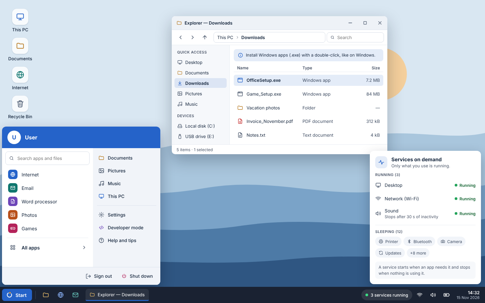
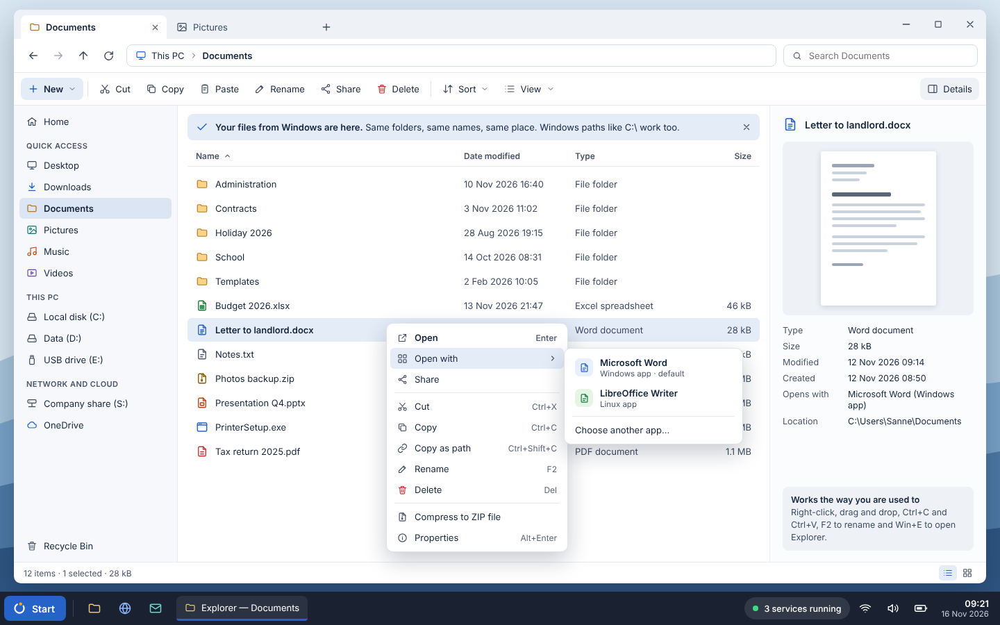
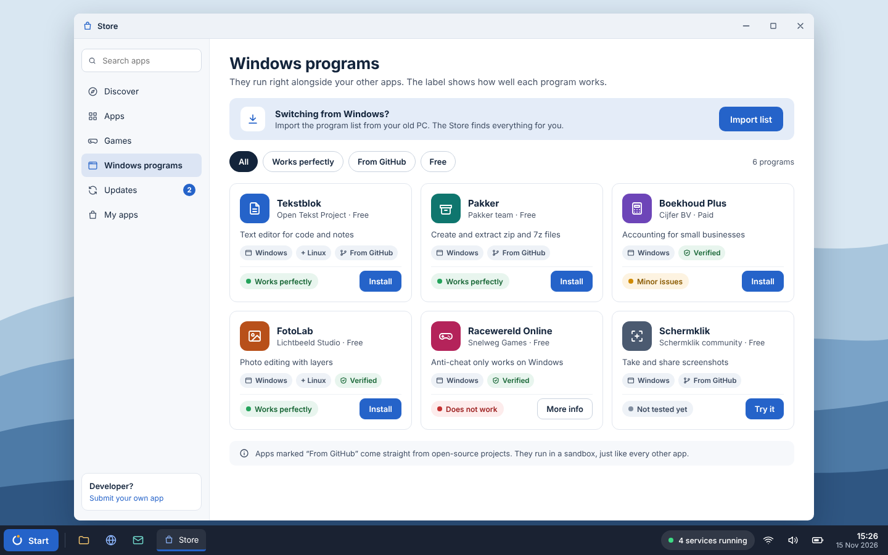
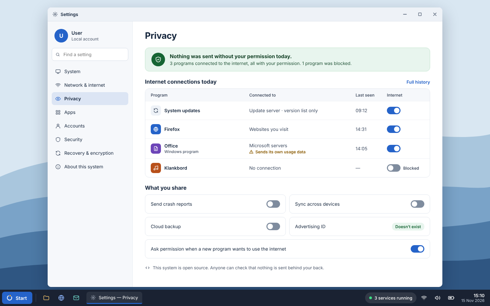
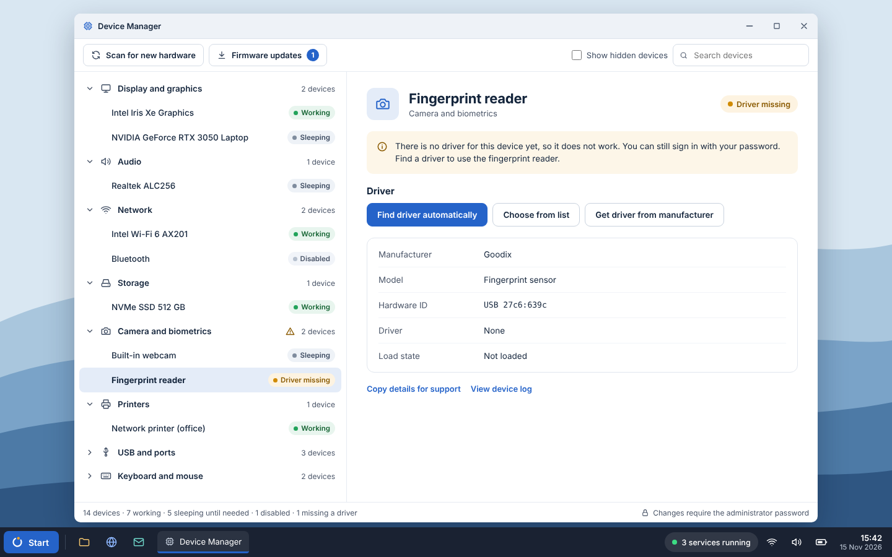
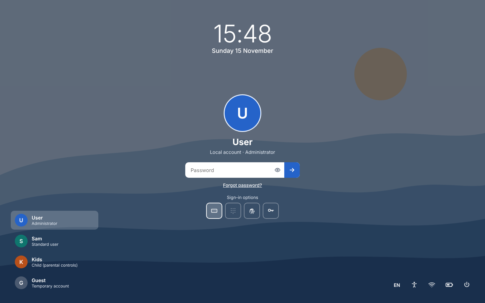
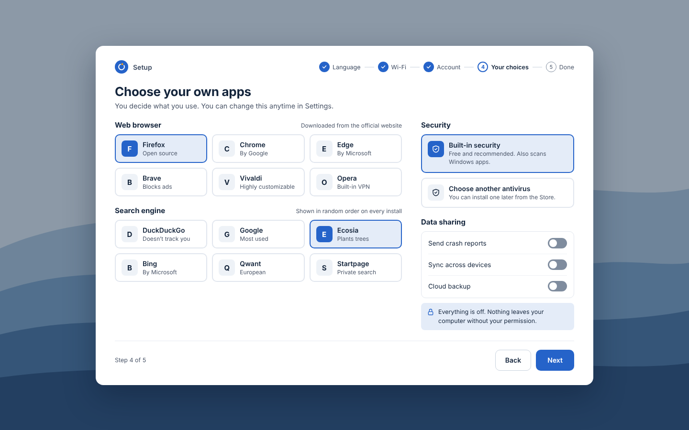
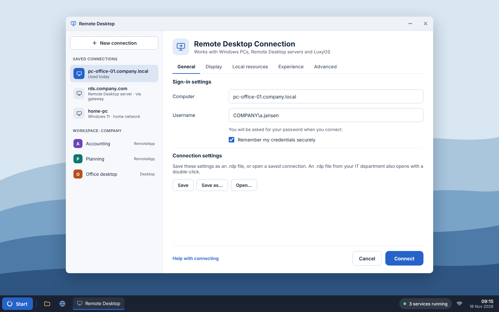

<h1 align="center">LuxyOS</h1>

<strong>A fast, free and honest operating system.</strong> 
It only starts what you use, runs your Windows programs, and sends nothing without your permission.

<a href="https://luxyos.com"><strong>luxyos.com</strong></a> · <a href="https://luxyos.com/nl/">Nederlands</a> · <a href="#how-to-help">Help build it</a> · <a href="https://paypal.me/nijazo">Donate to LuxyOS</a>

---

> **Status: design phase.** There is no source code yet. This repository holds the plan, the designs and the decisions, so that developers can help shape and build the first version. **Our goal is a first test version in 2027.** We are looking for developers and sponsors; see [How to help](#how-to-help) and [Support LuxyOS](#support-luxyos).

## What LuxyOS is

| Promise | What it means |
| --- | --- |
| **Fast (on-demand)** | At boot only a small *broker* runs. Services and drivers start when an app asks for them and stop when nobody uses them. Closing a program really closes it. |
| **Windows programs** | `.exe` files install with a double click, via Wine and Proton. Honest compatibility labels show what works. |
| **Privacy** | No telemetry, no advertising ID, no ads. Nothing leaves the computer without the user's permission. |
| **Free and non-commercial** | LuxyOS is free for everyone: no paid editions, no ads, no data sales. Registration is optional; security updates are for everyone. |
| **Free store for developers** | Developers list their apps for free, with no commission. Paid apps are sold on the developer's own website. See [docs/terms.md](docs/terms.md). |
| **Choice** | The user picks browser, search engine and antivirus. Administrators decide whether AI is allowed, local only, or blocked. |
| **Business ready** | Active Directory, Remote Desktop (server and client), certificates, PowerShell, a winget-like package manager and remote management. |
| **Familiar** | A desktop layout that Windows users recognise, with its own look. Easy to use without a command line. |
| **Made for Europe** | Built in and for the EU. EU law (GDPR, Cyber Resilience Act, Accessibility Act, AI Act) is the baseline in every country. Anyone may use LuxyOS; partners must follow EU rules. See [docs/europe.md](docs/europe.md). |

## What it will look like

These designs show the end result we are building towards. Names, numbers and apps are examples. All screens: [docs/design/](docs/design/).

 Explorer: the layout Windows users know, so they find their documents and pictures straight away

<table>
<tr>
<td width="50%"> Store: Windows programs with honest compatibility labels</td>
<td width="50%"> Privacy overview: which app connected to what</td>
</tr>
<tr>
<td> Device Manager: drivers in plain language</td>
<td> Sign-in screen: local, Active Directory or Entra ID</td>
</tr>
<tr>
<td> First start: the user chooses browser, search engine and antivirus</td>
<td> Built-in Remote Desktop app for Windows servers</td>
</tr>
</table>

## Technical direction

LuxyOS is built on the **Linux kernel**, with its own on-demand **broker** (Rust), a desktop built with **Qt 6** on **Wayland**, and **Wine / DXVK / VKD3D-Proton** for Windows software. See [docs/architecture.md](docs/architecture.md) and the [decision records](docs/decisions/).

## Documentation

| Document | Contents |
| --- | --- |
| [docs/vision.md](docs/vision.md) | Vision, target groups and launch rules |
| [docs/architecture.md](docs/architecture.md) | Layers, components and how on-demand works |
| [docs/requirements.md](docs/requirements.md) | What must work, per area and per target group |
| [docs/roadmap.md](docs/roadmap.md) | Phases and the first build steps |
| [docs/terms.md](docs/terms.md) | Terms: free and non-commercial, and the store terms for developers |
| [docs/europe.md](docs/europe.md) | Made for Europe: EU law as the baseline and what it means for LuxyOS |
| [docs/languages.md](docs/languages.md) | Languages, regions and translation |
| [docs/brand.md](docs/brand.md) | Logo, colours and animation |
| [website/](website/) | The website [luxyos.com](https://luxyos.com) in 11 languages, and how it is built |
| [docs/design/](docs/design/) | Screen designs (desktop, store, privacy, device manager, Remote Desktop and more) |
| [docs/decisions/](docs/decisions/) | Architecture decision records (ADRs) |
| [docs/good-first-tasks.md](docs/good-first-tasks.md) | Research and prototype tasks you can pick up now |
| [docs/nl/bouwnota.md](docs/nl/bouwnota.md) | The original, complete build note (Dutch) |

## How to help

Right now we need research, prototypes and review, not production code. Read [CONTRIBUTING.md](CONTRIBUTING.md) and pick a task from [issue #1: Start here](https://github.com/nijazo/luxyos/issues/1) or [docs/good-first-tasks.md](docs/good-first-tasks.md).

## Languages

The project language is **English**. LuxyOS itself starts with English (default), Dutch, Croatian, Bosnian, Serbian, Albanian, Macedonian, Turkish, German, French and Spanish, followed by all official EU languages. See [docs/languages.md](docs/languages.md).

## Support LuxyOS

LuxyOS is free and non-commercial. It is paid for by donations, grants and sponsors, never by users, ads or data.

<a href="https://paypal.me/nijazo"><strong>Donate to LuxyOS</strong></a> · via PayPal (paypal.me/nijazo)

- Donations pay for servers, test hardware, development and legal advice (trademark, CRA, privacy).
- Donating is voluntary and gives no rights or influence over the product ([LEGAL.md](LEGAL.md)).
- We plan to publish a yearly overview of what comes in and what it is spent on.
- Sponsoring as a company or organisation? E-mail **sponsors@luxyos.com**.
- Donors are anonymous unless they ask to be on the supporters list on luxyos.com ([terms](docs/terms.md#supporters-list-optional)).

## Ownership

LuxyOS is a project founded and owned by **Nijaz Omanovic**. It is an own design: nothing is copied from other operating systems; it is built from what users say they want, so some familiar functions can resemble well-known systems. No rights can be derived from the plans and designs. See [LEGAL.md](LEGAL.md).

## Licence

| What | Licence |
| --- | --- |
| The operating system | [GPL-3.0-or-later](LICENSE) |
| The SDK for app developers | [Apache-2.0](LICENSE-APACHE) |
| Documentation and designs | [CC BY 4.0](LICENSE-CC-BY) |

The LuxyOS name and logo are trademarks ([TRADEMARKS.md](TRADEMARKS.md)). Details: [LICENSING.md](LICENSING.md).

---

Website: <a href="https://luxyos.com">luxyos.com</a> (11 languages)

