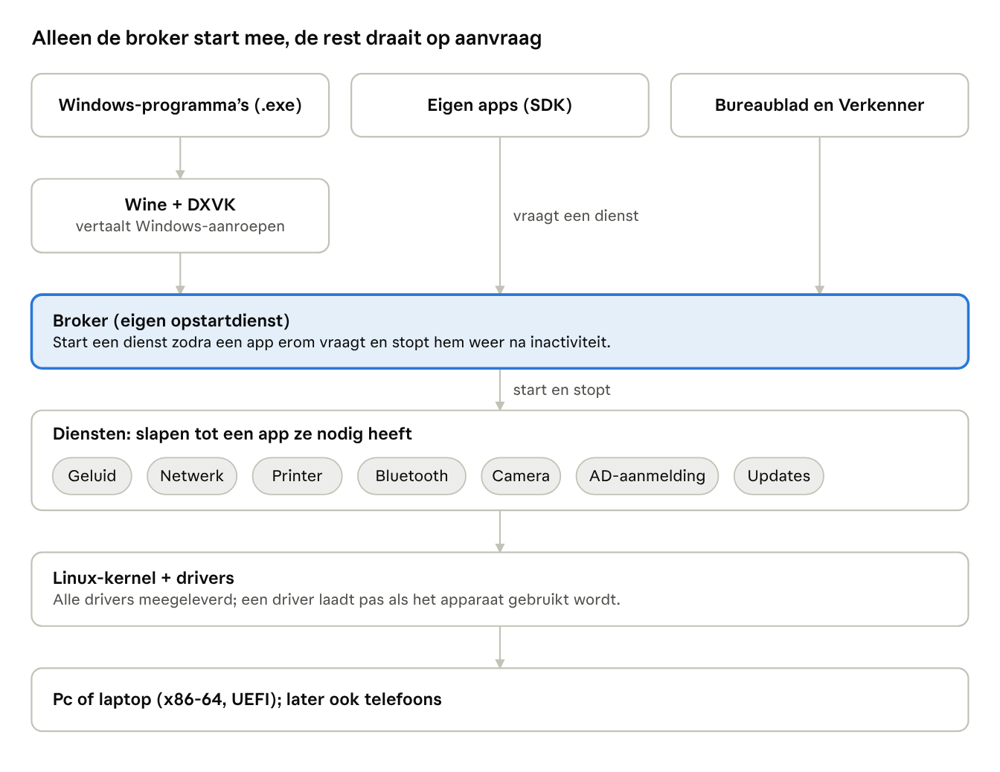

<h1 align="center">LuxyOS</h1>

<strong>A fast, free and honest operating system.</strong> 
It only starts what you use, runs your Windows programs, and sends nothing without your permission.

---

> **Status: design phase.** There is no source code yet. This repository holds the plan, the designs and the decisions, so that developers can help shape and build the first version.

## What LuxyOS is

| Promise | What it means |
| --- | --- |
| **Fast (on-demand)** | At boot only a small *broker* runs. Services and drivers start when an app asks for them and stop when nobody uses them. Closing a program really closes it. |
| **Windows programs** | `.exe` files install with a double click, via Wine and Proton. Honest compatibility labels show what works. |
| **Privacy** | No telemetry, no advertising ID, no ads. Nothing leaves the computer without the user's permission. |
| **Free** | LuxyOS is free. Registration is always optional; security updates are for everyone. |
| **Choice** | The user picks browser, search engine and antivirus. Administrators decide whether AI is allowed, local only, or blocked. |
| **Business ready** | Active Directory, Remote Desktop (server and client), certificates, PowerShell, a winget-like package manager and remote management. |
| **Familiar** | A desktop layout that Windows users recognise, with its own look. Easy to use without a command line. |

## Technical direction

LuxyOS is built on the **Linux kernel**, with its own on-demand **broker** (Rust), a desktop built with **Qt 6** on **Wayland**, and **Wine / DXVK / VKD3D-Proton** for Windows software. See [docs/architecture.md](docs/architecture.md) and the [decision records](docs/decisions/).

## Documentation

| Document | Contents |
| --- | --- |
| [docs/vision.md](docs/vision.md) | Vision, target groups and launch rules |
| [docs/architecture.md](docs/architecture.md) | Layers, components and how on-demand works |
| [docs/requirements.md](docs/requirements.md) | What must work, per area and per target group |
| [docs/roadmap.md](docs/roadmap.md) | Phases and the first build steps |
| [docs/languages.md](docs/languages.md) | Languages, regions and translation |
| [docs/brand.md](docs/brand.md) | Logo, colours and animation |
| [docs/design/](docs/design/) | Screen designs (desktop, store, privacy, device manager, Remote Desktop and more) |
| [docs/decisions/](docs/decisions/) | Architecture decision records (ADRs) |
| [docs/good-first-tasks.md](docs/good-first-tasks.md) | Research and prototype tasks you can pick up now |
| [docs/nl/bouwnota.md](docs/nl/bouwnota.md) | The original, complete build note (Dutch) |

## How to help

Right now we need research, prototypes and review, not production code. Read [CONTRIBUTING.md](CONTRIBUTING.md) and pick a task from [docs/good-first-tasks.md](docs/good-first-tasks.md).

## Languages

The project language is **English**. LuxyOS itself starts with English (default), Dutch, Croatian, Bosnian, Serbian, Albanian, Macedonian, Turkish, German, French and Spanish, followed by all official EU languages. See [docs/languages.md](docs/languages.md).

## Licence

To be decided before the first code is published. See [LICENSE.md](LICENSE.md).

---

luxyos.com · luxyos.nl · luxyos.eu

