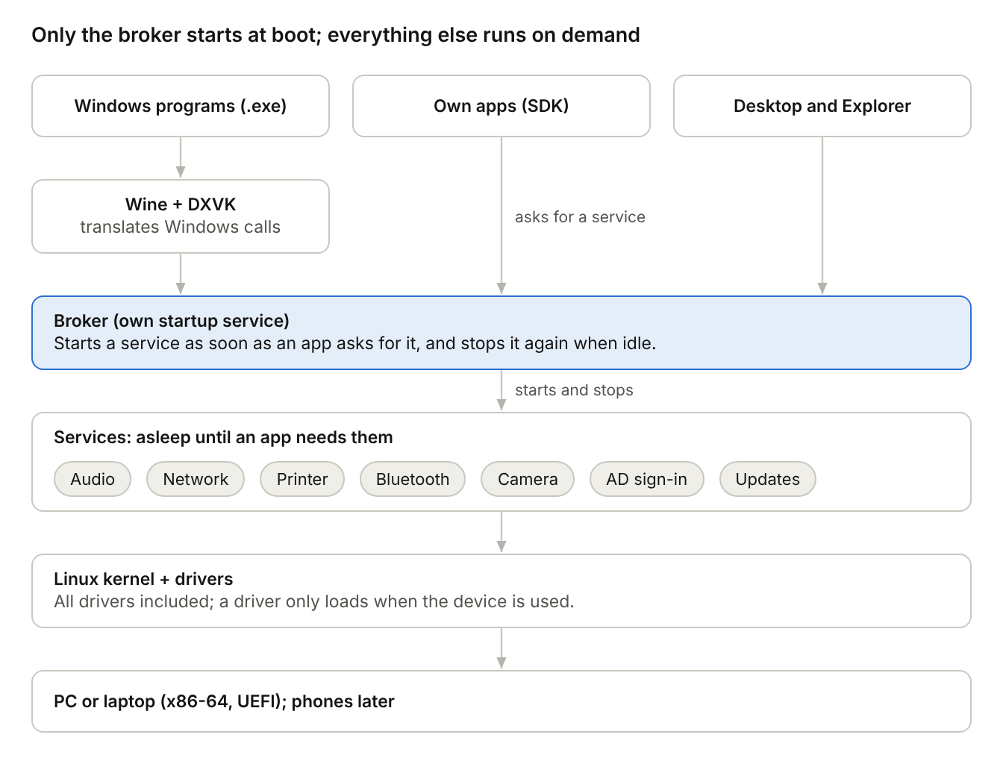

# Architecture

LuxyOS reuses proven open-source components and builds its own parts where LuxyOS is different: the broker, the store, settings, the migration assistant and the privacy overview.



## Layers

| Layer | Component | Choice |
| --- | --- | --- |
| Base | Kernel | Linux LTS |
| Base | Boot | systemd-boot or Limine, shim for Secure Boot, Unified Kernel Image |
| Base | Broker (on-demand services) | **Own**, written in Rust |
| Base | C library | glibc (needed for Steam, Wine and commercial software) |
| Desktop | Display | Wayland, XWayland for older apps |
| Desktop | Shell and windows | **Own** desktop with a familiar layout, built with Qt 6 |
| Desktop | Graphics | Mesa (AMD, Intel) and NVIDIA driver, Vulkan |
| Desktop | Audio | PipeWire |
| Windows | Compatibility | Wine, DXVK, VKD3D-Proton, Wine Mono, NTSYNC |
| Apps | Store and packages | **Own** store and `app` package manager, Flatpak for Linux apps |
| Network | Connections and firewall | NetworkManager, nftables, per-app firewall |
| Network | Printing, Bluetooth | CUPS (IPP Everywhere), BlueZ |
| Security | Encryption | LUKS2 with TPM 2.0 |
| Security | Sandbox | bubblewrap and Landlock |
| Security | Antivirus, firmware | IT DeXt Antivirus, built in and free (users can choose another); fwupd |
| Security | Certificates | p11-kit, NSS, OpenSC, tpm2-pkcs11, certmonger |
| Business | Directory and management | SSSD, realmd, Samba, Kerberos, Himmelblau (Entra ID), PowerShell 7 |
| Business | Remote Desktop | RDP server (KRdp / GNOME Remote Desktop / FreeRDP), RDP client on FreeRDP with an own interface |
| Storage | System | Read-only system image with A/B updates |
| Storage | Data | Btrfs with snapshots |

## The broker (on-demand)

```
Boot
 → kernel starts the broker
 → broker starts only: display, login screen
 → services are registered, not running

App asks for a service (for example audio)
 → broker starts the service and hands over the connection
 → no use for N seconds → broker stops the service

User closes the last window of an app
 → all processes of that app (its cgroup) stop after a short save period
```

Requirements:

- Socket- and D-Bus-style activation, so a service starts on its first request.
- Each app runs in its own process group (cgroup). Background running needs permission and is shown in the system tray; idle background apps are frozen.
- A systemd-compatible interface for third-party agents (RMM tools expect systemd units).
- Every scheduled task is visible in one list. Task Manager shows why each process runs.

## Windows software: three layers

| Layer | For | Quality |
| --- | --- | --- |
| 1. Wine / Proton | Most Windows programs and games | Good for most programs |
| 2. Integrated Windows environment (temporary fallback) | Adobe, AutoCAD, AVEVA | Near perfect; goal is to remove this layer |
| 3. Remote (RDP, Citrix, AVD) | Companies with their own servers | Perfect, with a good connection |

Long-term goal: a "Proton for work" team (with CodeWeavers) that makes professional software run in layer 1.

Not possible: Windows kernel drivers (`.sys`) and kernel anti-cheat. See [decisions/0002](decisions/0002-windows-software-via-wine-and-proton.md).

## Performance targets

| Target | Value |
| --- | --- |
| Boot to login on SSD | about 5 seconds |
| Minimum hardware | 64-bit CPU with 2 cores, 4 GB RAM, 32 GB storage, no TPM required |
| Recommended | 4+ cores, 8 GB RAM (16 GB for games), NVMe SSD, Vulkan 1.3 GPU |

Speed measures: foreground app priority, compressed system image, zram, background updates with low priority, no telemetry or ad services, search index only when idle.
