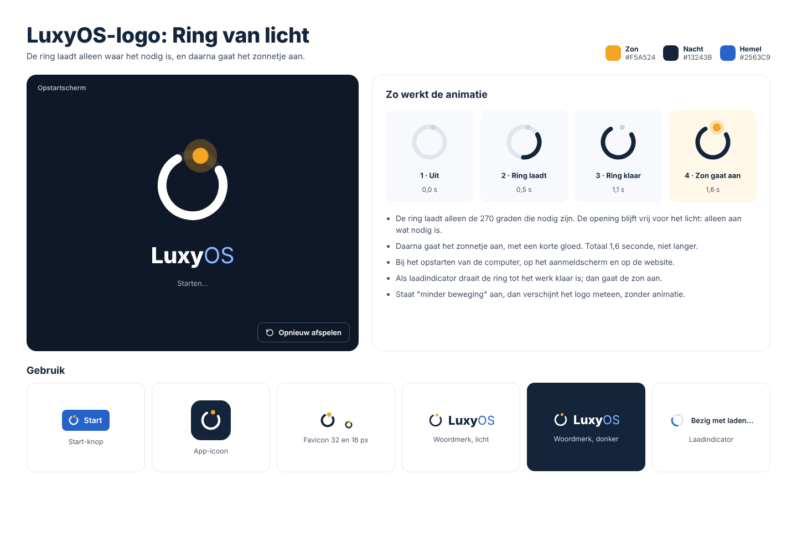

# Brand

## Logo: Ring of light

A ring that is almost closed, with a small sun in the opening. The ring only loads where it is needed, then the sun switches on: the on-demand idea in one image.

| File | Use |
| --- | --- |
| [luxyos-logo.svg](../brand/luxyos-logo.svg) | Logo on light backgrounds |
| [luxyos-logo-white.svg](../brand/luxyos-logo-white.svg) | Logo on dark backgrounds |
| [luxyos-app-icon.svg](../brand/luxyos-app-icon.svg), [512 px PNG](../brand/luxyos-app-icon-512.png) | App icon |
| [luxyos-logo-animated.svg](../brand/luxyos-logo-animated.svg) | Animation |

## Colours

| Name | Hex | Use |
| --- | --- | --- |
| Sun | `#F5A524` | The sun, highlights |
| Night | `#13243B` | The ring on light backgrounds, dark surfaces |
| Sky | `#2563C9` | Buttons, "OS" in the wordmark |

## Animation

1. The ring draws the 270 degrees it needs in 1.1 s.
2. The sun switches on with a short glow. Total 1.6 s.
3. As a loading indicator, the ring spins until the work is done, then the sun switches on.
4. With "reduce motion" enabled, the logo appears immediately without animation.

Used on the boot screen, login screen, Start button, app icon, favicon and website.

## Wordmark

"Luxy" bold, "OS" regular in Sky blue.

To do: check for similarity with existing logos before registering the trademark.
