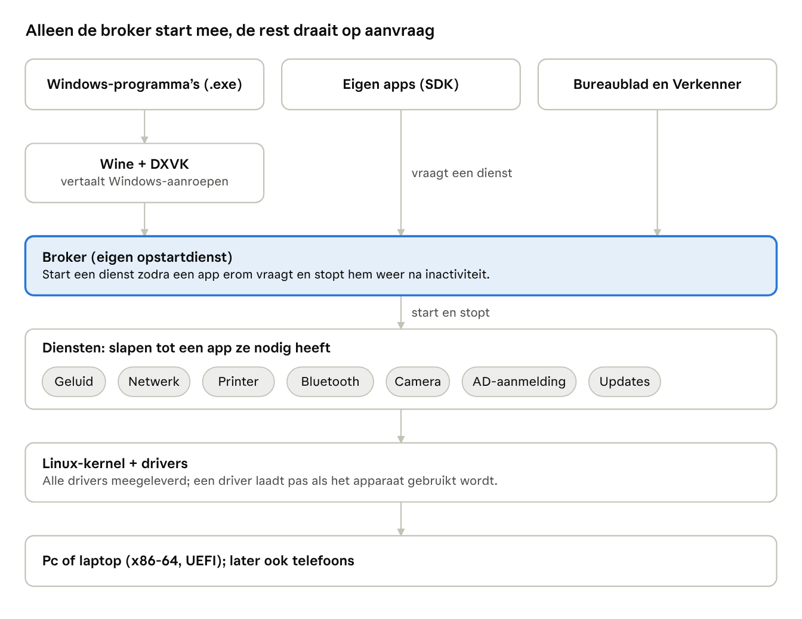
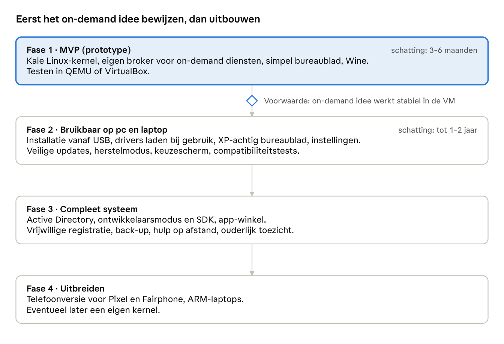

# Bouwnota LuxyOS

Stand: 15 november 2026

**Steun LuxyOS: [Donatie LuxyOS](https://paypal.me/nijazo)** via PayPal (paypal.me/nijazo). LuxyOS is gratis en niet-commercieel; donaties betalen servers, testapparatuur en ontwikkeling.

## Visie en uitgangspunten

LuxyOS is een snel besturingssysteem dat alleen start wat de gebruiker vraagt, Windows-programma's draait en makkelijk te bedienen is.

- **Snel (on-demand)**: bij het opstarten draait alleen een broker. Diensten starten pas als een app erom vraagt en stoppen weer na gebruik. Een afgesloten programma stopt helemaal: er blijft niets op de achtergrond draaien.
- **Windows-programma's**: installeren en werken zoals op Windows, via een compatibiliteitslaag.
- **Makkelijke bediening**: een gewone gebruiker heeft nooit een opdrachtregel nodig.
- **Vertrouwd bureaublad**: indeling zoals Windows XP, met een eigen ontwerp.
- **Gratis**: registratie is altijd vrijwillig.
- **Keuzevrijheid**: de gebruiker kiest zelf antivirus, webbrowser en zoekmachine. De beheerder bepaalt of AI is toegestaan, alleen lokaal mag, of geblokkeerd is.
- **Privacy**: niets verlaat het systeem zonder toestemming van de gebruiker. Geen telemetrie, geen advertenties, geen verkoop van gegevens.

## Bestaande systemen en wat dit OS anders maakt

De losse onderdelen bestaan al, maar geen enkel systeem combineert ze. Dat combineren is wat dit OS uniek maakt.

| Systeem | Wat het doet | Verschil met dit OS |
| --- | --- | --- |
| Zorin OS | Linux met Windows-achtig bureaublad. Een .exe installeert via Wine | Komt het dichtst bij. Geen on-demand diensten en geen privacyoverzicht per app |
| SteamOS (Valve) | Linux dat Windows-games draait via Proton | Alleen gericht op gaming |
| Windows 11 met WSL | Windows dat Linux-programma's draait | Andersom: Windows als basis, met telemetrie en achtergronddiensten |
| ChromeOS | Draait Linux- en Android-apps | Windows-programma's alleen via dure bedrijfsoplossingen |
| ReactOS | Kloon van Windows | Geen Linux, nog niet stabiel |
| Lindows / Linspire (2001–2008) | Linux dat Windows-programma's draait | Mislukt: beloofde te veel en verloor een rechtszaak over de naam |

**Les van Lindows**: beloof niet dat alle Windows-programma's werken. De compatibiliteitslabels zijn eerlijk over wat werkt, en een eigen naam voorkomt merkproblemen.

**Wat niemand nog combineert**

- On-demand diensten: alleen draaien wat nodig is.
- Privacy als kernbelofte: per app zien en blokkeren wat er verstuurd wordt.
- Eén winkel met Windows-, Linux- en GitHub-apps, met compatibiliteitslabels.
- Zakelijk klaar: Active Directory, monitoringsoftware, PowerShell en een pakketbeheerder zoals winget.
- Bediening zoals Windows XP, vertrouwd voor overstappers.

Zorin OS is het beste voorbeeld om eerst te bekijken en te testen.

## Doelgroepen: pas aanbieden als alles werkt

Voor gebruikers is het simpel: werkt iets niet, dan gebruiken ze het niet. Daarom gaat een doelgroep pas open als alles op zijn lijst werkt. Zakelijk is de belangrijkste groep: veel bedrijven willen van Windows af, maar er is nog geen echt werkend alternatief.

| Volgorde | Doelgroep | Moet allemaal werken | Haalbaar |
| --- | --- | --- | --- |
| 1 | Privé: internet, mail, foto's | Browser, e-mail, foto's en video, printen, wifi, slaapstand, updates, telefoon koppelen | Ja, met bestaande onderdelen |
| 2 | Zakelijk: kantoorwerk | Microsoft 365 (web en desktop), Outlook, Teams, pdf, VPN, AD en Entra ID, beheer op afstand, printers, beveiliging | Grotendeels. Office-desktop met macro's is het grootste werk |
| 3 | Gamers | Steam en Proton, controllers, videokaartdrivers, één klik naar Windows voor games met anti-cheat | Deels. Anti-cheat hangt af van de makers |
| 4 | Zakelijk: techniek en industrie | Adobe, AutoCAD, AVEVA en andere vakprogramma's | Jaren werk en medewerking van de makers |

**Zakelijk kantoorwerk is de grootste kans**

- Veel bedrijfssoftware draait tegenwoordig in de browser (boekhouding, CRM, ERP). Dat werkt meteen.
- Microsoft 365 werkt volledig in de browser. Office-desktop met macro's is het belangrijkste wat via Wine moet werken.
- Veel VPN-programma's (zoals Cisco en GlobalProtect) hebben al een Linux-versie.
- Europa wil minder afhankelijk zijn van Amerikaanse software. Overheden zoals Sleeswijk-Holstein en Denemarken stappen al over.

**Zo winnen we bedrijven**

1. Een scan "Werkt het voor jouw bedrijf?": de tool leest welke programma's een bedrijf gebruikt en geeft per programma een label, net als de gamecontrole.
2. Proefprojecten met IT-bedrijven bij een paar klanten (mkb, scholen, gemeenten), vóór de brede lancering.
3. Een LTS-versie met lange ondersteuning, een helpdesk en vaste afspraken over oplostijden.
4. Op de website per doelgroep eerlijk laten zien wat klaar is: "Klaar voor privé en kantoor, gaming deels, techniek nog niet".

## Technische basis

Start met de kale Linux-kernel en bouw alles daarboven zelf. Een eigen kernel kan later.

| Onderdeel | Keuze | Opmerking |
| --- | --- | --- |
| Kernel | Linux-kernel, zonder distributie | Drivers voor de meeste hardware zitten erin |
| Opstartdienst | Eigen broker | Start diensten op aanvraag en stopt ze na inactiviteit |
| Drivers | Alles meeleveren, laden bij gebruik | De webcam-driver laadt bijvoorbeeld pas als een app de camera opent |
| Bootloader | GRUB, Limine of systemd-boot | Met shim voor Secure Boot |
| Systeem bouwen | Buildroot of Yocto | Bouwt een minimaal systeem op maat |
| Installatie | Vanaf USB-stick | Schijf indelen (GPT), bestandssysteem maken, bestanden kopiëren, bootloader plaatsen |
| Testen | Eerst in QEMU of VirtualBox | Pas daarna op een echte computer |

Ook bekeken: ReactOS (NT-kloon, nog alpha) en een eigen microkernel zoals Redox of seL4 (veel jaren werk).



Apps vragen een dienst aan de broker. De broker start die dienst en stopt hem weer als niemand hem gebruikt.

## Onderdelen, snelheid en hardware-eisen

Het systeem bestaat grotendeels uit bestaande open-source onderdelen. De eigen bouw zit in de broker, winkel, instellingen, overstap-tool en het privacyoverzicht.

**Alle onderdelen**

| Laag | Onderdeel | Keuze |
| --- | --- | --- |
| Basis | Kernel | Linux LTS-versie |
| Basis | Opstarten | systemd-boot of Limine, met shim voor Secure Boot |
| Basis | Broker (on-demand diensten) | Eigen bouw, in Rust |
| Basis | C-bibliotheek | glibc, nodig voor Steam, Wine en commerciële software |
| Bureaublad | Grafisch systeem | Wayland, met XWayland voor oudere apps |
| Bureaublad | Bureaublad en vensters | Eigen XP-achtige omgeving, gebouwd met Qt 6 |
| Bureaublad | Grafische drivers | Mesa (AMD, Intel) en NVIDIA-driver, met Vulkan |
| Bureaublad | Geluid | PipeWire |
| Windows | Compatibiliteit | Wine, DXVK, VKD3D-Proton, Wine Mono |
| Apps | Winkel en pakketbeheer | Eigen winkel, Flatpak voor Linux-apps |
| Netwerk | Verbindingen en firewall | NetworkManager, nftables, firewall per app |
| Netwerk | Printen en Bluetooth | CUPS, BlueZ |
| Beveiliging | Versleuteling | LUKS2 met TPM |
| Beveiliging | Sandbox | bubblewrap en Landlock |
| Beveiliging | Antivirus en firmware | ClamAV, fwupd |
| Zakelijk | Domein en beheer | SSSD, realmd, Samba, Kerberos, PowerShell 7 |
| Opslag | Systeem | Alleen-lezen systeemdeel met A/B-updates |
| Opslag | Gegevens | Btrfs met snapshots |

**Snel opstarten en werken**

1. Snel opstarten: de kernel start direct (Unified Kernel Image), en de broker start alleen bureaublad en inlogscherm. Doel: binnen ongeveer 5 seconden bij het inlogscherm op een SSD.
2. On-demand: diensten en drivers laden pas bij gebruik.
3. Voorrang voor wat je gebruikt: het programma op de voorgrond krijgt voorrang op processor en schijf.
4. Gecomprimeerd systeemdeel: klein en snel te lezen.
5. Gecomprimeerd geheugen (zram) in plaats van traag wegschrijven naar de schijf.
6. Snelle Windows-programma's: NTSYNC in de kernel, en shaders vooraf klaarzetten zodat games niet haperen.
7. Updates op de achtergrond met lage prioriteit, actief bij de volgende start.
8. Geen ballast: geen telemetrie of reclamediensten. De zoekindex draait alleen als de computer niets doet.

**Alleen starten wat nodig is, en echt afsluiten**

- Bij het opstarten start niets wat niet nodig is: geen diensten, processen of hulpprogramma's van apps.
- Opstartprogramma's staan standaard uit. De gebruiker zet ze zelf aan in een overzicht.
- Afsluiten is echt afsluiten. Elk programma draait in een eigen groep processen. Sluit de gebruiker het laatste venster, dan stopt de hele groep na een paar seconden om op te slaan, inclusief alle hulpprocessen.
- Op de achtergrond draaien mag alleen met toestemming van de gebruiker, bijvoorbeeld voor muziek of een download. Zo'n app staat zichtbaar in het systeemvak en krijgt lage prioriteit.
- Een app op de achtergrond die niets doet, wordt bevroren tot hij weer nodig is.
- Windows-programma's: als het laatste venster sluit, stopt Wine ook alle bijbehorende Windows-diensten. Updaters en geplande taken van Windows-programma's starten alleen met toestemming.
- Geen verborgen geplande taken: alles wat op een vast tijdstip draait, staat zichtbaar in één lijst.
- Taakbeheer toont bij elk proces waarom het draait en wie het startte.

**Hardware-eisen**

| Onderdeel | Minimaal | Aanbevolen |
| --- | --- | --- |
| Processor | 64-bit, 2 kernen | 4 kernen of meer |
| Geheugen | 4 GB | 8 GB, voor games 16 GB |
| Opslag | 32 GB, SSD aangeraden | 128 GB NVMe-SSD |
| Videokaart | Elke kaart | Vulkan 1.3, voor Windows-games |
| TPM-chip | Niet nodig | Aanbevolen, voor automatisch ontgrendelen |

Het OS draait ook op pc's die Windows 11 weigert, bijvoorbeeld zonder TPM 2.0 of met een oudere processor.

## Batterij en energie op laptops

Op batterij schakelt het systeem automatisch naar zuinig. Alleen de apps die open staan krijgen energie; de rest slaapt of staat uit.

**Automatisch, zonder instellen**

| Situatie | Wat het systeem doet |
| --- | --- |
| Aan de lader | Gebalanceerd of prestaties |
| Op batterij | Zuinig: processor, scherm en apparaten in spaarstand |
| Batterij onder 20% | Extra zuinig: achtergrondtoestemmingen tijdelijk uit, scherm donkerder |
| Batterij onder 5% | Slaapstand naar schijf, zodat er geen werk verloren gaat |

**Alleen open apps krijgen energie**

- Geminimaliseerde apps zonder achtergrondtoestemming worden bevroren.
- Wekmomenten van apps worden gebundeld, zodat de processor langer kan slapen.
- Geen synchroniseren of controleren op de achtergrond zonder toestemming.
- Updates en de zoekindex draaien alleen aan de lader.
- Windows-programma's volgen dezelfde regels. Games krijgen op batterij een maximum aantal beelden per seconde.

**Apparaten uit als ze niet gebruikt worden**

- USB-apparaten, Bluetooth, webcam en vingerafdrukscanner gaan uit als ze niet in gebruik zijn.
- Wifi en de SSD gaan in spaarstand bij weinig verkeer.
- Laptops met twee videokaarten gebruiken standaard de zuinige ingebouwde. De losse videokaart gaat alleen aan voor games en zware programma's.
- Scherm: automatische helderheid en op batterij een lagere verversingssnelheid.

**Inzicht en batterijgezondheid**

- Batterijoverzicht per app, zoals op een telefoon: welke app gebruikt het meeste energie.
- Waarschuwing als een app op de achtergrond veel energie gebruikt.
- Laadlimiet van 80% instelbaar, voor een langere levensduur van de batterij (waar de laptop dat ondersteunt).
- Betrouwbare slaapstand: klep dicht is slapen, klep open is direct verder.

Basis: power-profiles-daemon en de energiebeheer-functies van de Linux-kernel.

## Windows-compatibiliteit

Programma's en games werken via vertaallagen. Echte Windows-drivers en anti-cheat werken niet.

| Wat | Hoe | Haalbaar? |
| --- | --- | --- |
| Programma's (.exe) | Wine vertaalt Windows-aanroepen | Grotendeels |
| Games | DXVK en VKD3D vertalen DirectX naar Vulkan | Ja, met een GPU-driver die Vulkan ondersteunt |
| Office 365 | Wine | Moeilijk. Oudere Office-versies werken beter, de webversie is de reserve |
| Windows-drivers (.sys) | De NT-kernel nabootsen | Zeer moeilijk. Gebruik eigen of open-source drivers |
| Anti-cheat | Diep verweven met de Windows-kernel | Praktisch onmogelijk |

De gebruiker ziet niets van Wine: dubbelklikken op een .exe installeert het programma en zet het in het startmenu.

**Windows-onderdelen (.NET en meer)**

Windows-onderdelen worden pas geïnstalleerd als een programma erom vraagt. Zo staat er nooit iets onnodigs aan.

| Onderdeel | Hoe | Haalbaar? |
| --- | --- | --- |
| .NET Framework 4.x (oudere programma's) | Wine Mono, of het echte .NET Framework in Wine installeren | Grotendeels |
| .NET 6 en nieuwer | Windows-versie in Wine. .NET is open source en draait ook op Linux | Goed |
| Visual C++-runtimes | Automatisch installeren als een programma ze nodig heeft | Goed |
| DirectX | DXVK en VKD3D (naar Vulkan) | Goed |
| Windows Installer (.msi) | Zit in Wine | Goed |
| Edge WebView2 (nodig voor o.a. nieuwe Outlook en Teams) | Wine | Lastig, aandachtspunt |
| Lettertypen (Arial, Segoe) | Vrije vervangers zoals Liberation en Carlito. Microsoft-lettertypen mag je niet meeleveren | Goed |

- Geen vooraf geïnstalleerde reclame- of proefsoftware.
- De gebruiker ziet alle geïnstalleerde onderdelen en kan ze verwijderen.

## Professionele software: Adobe, AutoCAD en AVEVA

Via Wine alleen werken deze programma's niet perfect. Ze leunen te zwaar op Windows: licentiediensten, .NET, DCOM, SQL Server en 3D-drivers. Daarom drie lagen. De gebruiker merkt er niets van: installeren uit de winkel, en het OS kiest zelf de juiste laag.

| Laag | Voor | Hoe goed |
| --- | --- | --- |
| 1. Wine | Lichte en gewone Windows-programma's | Goed voor de meeste programma's |
| 2. Ingebouwde Windows-omgeving | Adobe, AutoCAD, AVEVA en andere zware software | Bijna perfect: een echte Windows draait onzichtbaar in een virtuele machine, en de programma's verschijnen als gewone vensters |
| 3. Op afstand | Bedrijven met een eigen server, Citrix, Azure Virtual Desktop of Windows 365 | Perfect, zolang de verbinding goed is |

**Laag 2: de ingebouwde Windows-omgeving**

- Voorbeeld: het open-source project WinApps. Windows draait in KVM, en programma's verschijnen via RDP RemoteApp als losse vensters in het startmenu en de taakbalk.
- Bestanden, klembord en printers worden gedeeld met dit OS.
- 3D-snelheid voor AutoCAD en AVEVA E3D: met een tweede videokaart doorgegeven aan Windows, met SR-IOV op nieuwere Intel-chips, of zakelijk met NVIDIA vGPU.
- Nodig: een Windows-licentie en meer geheugen (16 GB of meer aanbevolen).
- Privacy: de Windows-omgeving valt onder de firewall per app. De gebruiker ziet en blokkeert wat Windows verstuurt.
- De omgeving start alleen als zo'n programma opent, en stopt daarna weer (on-demand).

**Per programma**

| Software | Beste laag | Opmerking |
| --- | --- | --- |
| Adobe Photoshop, Premiere, Illustrator | Laag 2 | Ook webversies van Photoshop en Express |
| AutoCAD | Laag 2 | Ook AutoCAD Web; zware 3D vraagt een tweede videokaart of SR-IOV |
| AVEVA (E3D, System Platform, InTouch, PI) | Laag 2 of 3 | Bij AVEVA nagaan welke virtualisatie ondersteund is, zodat de support geldig blijft |

**Op lange termijn**

- Met Adobe, Autodesk en AVEVA praten over een eigen versie voor dit OS of over ondersteuning van de Windows-omgeving.
- CodeWeavers (de makers achter Wine) inhuren om specifieke programma's in laag 1 te laten werken.

**Doel: alles in het eigen OS, zonder virtuele machine**

De Windows-omgeving (laag 2) is alleen een tijdelijke reserve. Het doel is dat Adobe, AutoCAD en AVEVA rechtstreeks in dit OS draaien. Dat kan op twee manieren: de compatibiliteitslaag zo goed maken dat deze programma's werken, of de makers een eigen versie laten maken.

**Een eigen "Proton voor werk"**

Valve maakte Proton door jarenlang te investeren in Wine, samen met CodeWeavers. Daardoor werken nu duizenden Windows-games. Hetzelfde kan voor professionele software:

1. Een vast team, samen met CodeWeavers, dat alleen aan professionele software werkt.
2. Een testlab met de 50 belangrijkste zakelijke programma's, automatisch getest bij elke nieuwe versie.
3. Alle verbeteringen teruggeven aan Wine, zodat de hele gemeenschap meehelpt.

| Software | Wat nu ontbreekt | Wat er moet gebeuren |
| --- | --- | --- |
| Adobe (Photoshop, Illustrator, Premiere) | Installatie en licentie via Creative Cloud, en GPU-versnelling | Bestaande Wine-aanpassingen voor de Creative Cloud-installatie afmaken, GPU via VKD3D en OpenCL |
| AutoCAD | .NET Framework 4.8 met WPF-schermen, DirectX-weergave en de licentiedienst van Autodesk | WPF in Wine verbeteren, de licentiedienst laten draaien, DirectX via VKD3D |
| AVEVA | DCOM en OPC, Windows-diensten, SQL Server, licentieserver en USB-sleutels | DCOM in Wine afmaken, de Linux-versie van SQL Server gebruiken, drivers voor USB-sleutels, certificering door AVEVA |

Grove schatting met een vast team: Adobe 1 tot 2 jaar, AutoCAD 2 tot 3 jaar. Voor AVEVA is goedkeuring van AVEVA zelf nodig, omdat bedrijven en fabrieken anders geen ondersteuning krijgen.

**Eigen versies van de makers**

- Met Adobe, Autodesk en AVEVA praten zodra het OS genoeg zakelijke gebruikers heeft.
- Autodesk heeft al Linux-versies van andere programma's, zoals Maya. Dat laat zien dat het kan.

## Gaming: Windows-games

De meeste Windows-games draaien via Proton bijna net zo snel als op Windows. Grote online shooters zoals Call of Duty en Battlefield werken niet, omdat de makers hun anti-cheat alleen op Windows toestaan. Dat is een keuze van de maker, geen technisch probleem van het OS.

| Game | Verhaal (offline) | Online | Waarom |
| --- | --- | --- | --- |
| GTA V | Werkt | Werkt niet | Rockstar blokkeert GTA Online op Linux sinds 2024 (BattlEye) |
| Call of Duty (Warzone, Black Ops) | Werkt niet | Werkt niet | Ricochet-anti-cheat diep in de Windows-kernel |
| Battlefield 6 en 2042 | Werkt niet | Werkt niet | EA Javelin-anti-cheat, eist Windows met Secure Boot |
| Elden Ring, Cyberpunk 2077, Baldur's Gate 3 | Werkt | Werkt | Geen probleem met anti-cheat |
| Counter-Strike 2 | Werkt | Werkt | Heeft een eigen Linux-versie |

De stand kan veranderen: makers zetten Linux-ondersteuning soms aan of uit.

**Aanpak**

1. **Proton, DXVK en VKD3D-Proton** meeleveren en bijhouden, met NTSYNC en shaders vooraf klaarzetten.
2. **Anti-cheat-makers benaderen**: Easy Anti-Cheat en BattlEye kunnen Linux al ondersteunen als de gamemaker het aanzet. Hoe meer gebruikers, hoe sterker die vraag.
3. **"Naast Windows" voor deze games**: wie de overstap-tool met "Eerst proberen naast Windows" gebruikte, krijgt bij zo'n game de knop "Herstarten naar Windows om te spelen".
4. **Cloud gaming** als alternatief: GeForce NOW en Xbox Cloud Gaming draaien sommige van deze games via internet.
5. **Eerlijke labels** in de winkel en het controlerapport: "Werkt niet: anti-cheat", zodat niemand teleurgesteld raakt.

- Niet doen: games in een virtuele machine draaien. Anti-cheat herkent dat en blokkeert het account soms.

**Waarom anti-cheat niet te installeren is**

- Deze anti-cheat is een Windows-driver die in de Windows-kernel draait. Die past niet in de Linux-kernel, net zoals andere Windows-drivers (.sys) niet werken. Wine vertaalt alleen gewone programma's, geen drivers.
- De anti-cheat controleert of de computer een onveranderd Windows is. Windows nabootsen ziet eruit als valsspelen en kan een ban opleveren.
- Anti-cheat omzeilen is in strijd met de voorwaarden van de games. Niet doen.
- De makers vertrouwen een open kernel niet, omdat gebruikers die kunnen aanpassen.

**Lange termijn: een vertrouwde spelmodus**

- Een opstartmodus met Secure Boot, alleen een ondertekende kernel en controle via de TPM-chip, zodat aantoonbaar is dat er niets is aangepast.
- Met die basis samen met anti-cheat-makers een Linux-versie van hun driver maken, ondertekend voor dit OS.
- Dit lukt alleen met medewerking van de makers, en pas als het OS genoeg gebruikers heeft.

**Uitbrengen terwijl niet alle games werken**

Zelfs Valve kreeg Call of Duty en Battlefield niet op SteamOS. Daarom: gaming is bij de start geen hoofdbelofte, en gamers verliezen niets bij de overstap.

1. **Eerlijk vooraf**: op de website een controle "Werkt jouw game?". De gebruiker ziet per game wat werkt, vóór de installatie.
2. **Windows houden voor die paar games**: het controlerapport van de overstap-tool herkent games met anti-cheat en raadt dan "Eerst proberen naast Windows" aan.
3. **Eén klik naar Windows**: in de gamebibliotheek staat bij zo'n game "Herstarten naar Windows om te spelen". Na het spelen start de computer weer in dit OS.
4. **Cloud gaming ingebouwd**: GeForce NOW en Xbox Cloud Gaming direct vanuit de gamebibliotheek.
5. **Boodschap**: "De meeste games werken. Voor de rest: één klik naar Windows of de cloud."
6. **Druk opbouwen bij makers**: meewerken aan Proton, en een openbare lijst op de website waar spelers kunnen aangeven welke game ze willen. Geen telemetrie: alleen wat spelers zelf invullen.
7. **Eerst andere doelgroepen**: oude pc's, privacy, scholen en bedrijven. Gaming groeit mee als het aantal gebruikers groeit.

## Overstap-tool vanuit Windows

Een .exe op de website zet een Windows-pc in één keer over. Gegevens, programma's en licenties gaan mee, en er is altijd een weg terug. Voorbeelden: Wubi (Ubuntu installeren vanuit Windows), Migratie-assistent van Apple en PCmover van Laplink. Ontwerp: [Overstap-assistent](design/07-overstap-controlerapport.png).

1. De gebruiker downloadt "Overstappen.exe" en start hem in Windows.
2. Controlerapport: werkt de hardware, en welke programma's werken? Er verandert nog niets.
3. Gegevens verzamelen: bestanden, browsers, wachtwoorden, wifi en licenties.
4. Back-up: een volledig image van Windows, de weg terug.
5. Herstart: het nieuwe OS wordt geïnstalleerd.
6. Programma's opnieuw installeren via de winkel, daarna instellingen en licenties terugzetten.
7. Inloggen: bureaublad, bestanden en browsertabbladen staan klaar. De gebruiker gaat verder waar hij gebleven was.

| Onderdeel | Meenemen? |
| --- | --- |
| Bestanden (Documenten, Foto's, Bureaublad) | Ja |
| Bladwijzers, browserwachtwoorden, open tabbladen | Ja. Wachtwoorden uitlezen terwijl Windows nog draait |
| Wifi-wachtwoorden, achtergrond, printers | Ja |
| E-mail, ook Outlook-bestanden | Grotendeels |
| Programma's | Niet kopiëren maar opnieuw installeren via de winkel, daarna instellingen terugzetten |
| Licenties met account (Microsoft 365, Adobe, Steam) | Opnieuw inloggen |
| Licenties met een sleutel | Vaak uit te lezen en terug te zetten |
| Licenties gekoppeld aan hardware | Soms opnieuw activeren |
| Programma's die niet werken (anti-cheat) | Vooraf melden |

- Altijd eerst een controlerapport, voordat er iets verandert.
- Twee keuzes: eerst proberen naast Windows, of Windows vervangen.
- Het Windows-image blijft bewaard: 30 dagen lang een knop "Terug naar Windows".
- BitLocker: veel Windows 11-pc's zijn versleuteld. De tool regelt dat eerst.
- Waarschuwingen: laptop aan de lader, genoeg schijfruimte, of een externe schijf voor de back-up.
- Licenties zo goed mogelijk meenemen. Meld vooraf welke programma's opnieuw geactiveerd moeten worden.

## Bureaublad en bediening

De indeling lijkt op Windows XP, maar het uiterlijk is eigen. Het XP-ontwerp zelf is van Microsoft. Voorbeeld: [Bureaublad-ontwerp](design/01-bureaublad-startmenu.png).

**Verkenner zoals gebruikers gewend zijn.** Na de overstap werkt iedereen gewoon door en vindt meteen documenten en afbeeldingen terug:

- Dezelfde mappen met dezelfde namen: Bureaublad, Downloads, Documenten, Afbeeldingen, Muziek, Video's. Bestanden van Windows staan op dezelfde plek.
- Links Snelle toegang, Deze pc met stationsletters (C:, D:, E:), netwerkschijven (S:) en cloudopslag.
- Tabbladen, adresbalk met kruimelpad die ook Windows-paden zoals C:\Users\Naam\Documents begrijpt, en zoeken rechtsboven.
- Knoppen voor Nieuw, Knippen, Kopiëren, Plakken, Naam wijzigen, Delen en Verwijderen, plus een detailvenster met voorbeeld.
- Lijst met Naam, Gewijzigd op, Type en Grootte, met bekende typenamen zoals Word-document en Excel-werkblad.
- Rechtsklikmenu met de bekende opdrachten en sneltoetsen (Ctrl+C, F2, Del, Alt+Enter). Bij "Openen met" staan Windows- en Linux-apps naast elkaar.

Ontwerp: [Verkenner](design/21-verkenner.png).

- Taakbalk onderaan: Start-knop, snelkoppelingen, open vensters, systeemvak met klok.
- Startmenu met twee kolommen: programma's en zoekbalk links, mappen en instellingen rechts.
- Verkenner, rechtermuisknopmenu's en bureaubladpictogrammen.
- Het systeemvak toont welke diensten actief zijn.

Regels voor eenvoud:

1. Nooit een opdrachtregel nodig.
2. Installatie in hooguit 5 stappen: taal, wifi, gebruikersnaam, klaar.
3. Eén instellingenscherm. Geavanceerde opties zitten achter "Geavanceerd".
4. Begrijpelijke foutmeldingen met een oplossing erbij.
5. Updates op de achtergrond, zonder geforceerde herstarts.
6. Alles is terug te draaien met één klik.

## Logo en huisstijl

Het logo van LuxyOS is de Ring van licht: een ring die bijna rond is, met een zonnetje in de opening. De ring laadt alleen waar het nodig is, en daarna gaat het zonnetje aan. Dat is het on-demand idee in één beeld.

| Kleur | Code | Gebruik |
| --- | --- | --- |
| Zon | #F5A524 | Het zonnetje, accenten |
| Nacht | #13243B | De ring op licht, donkere achtergronden |
| Hemel | #2563C9 | Knoppen, "OS" in het woordmerk |

**Animatie**

1. De ring laadt in 1,1 seconde de 270 graden die nodig zijn.
2. Daarna gaat het zonnetje aan met een korte gloed. Totaal 1,6 seconde.
3. Als laadindicator draait de ring tot het werk klaar is; dan gaat de zon aan.
4. Staat "minder beweging" aan, dan verschijnt het logo meteen, zonder animatie.

- Gebruik: opstartscherm, aanmeldscherm, Start-knop, app-icoon, favicon en website.
- Woordmerk: "Luxy" vet, "OS" dun in Hemel-blauw.
- Bestanden staan in de GitHub-map `luxyos/logo`: logo, witte versie, app-icoon en de animatie.
- Nog doen: controleren op gelijkenis met bestaande logo's, en het logo laten vastleggen bij het merk.

## Gemaakt voor Europa

LuxyOS wordt gemaakt in en voor de EU, en de Europese wetten zijn de basis, in elk land. Mensen en bedrijven buiten de EU mogen LuxyOS gebruiken en krijgen dezelfde Europese bescherming.

- **Eén versie, één standaard.** Er komt geen zwakkere versie voor andere landen.
- **EU-wet is het minimum.** Vraagt een land meer bescherming, dan kan LuxyOS meer, maar nooit minder.
- **Gegevens blijven in Europa.** Updates, app-winkel, registratie en back-up draaien in de EU. Niets gaat buiten de EU zonder toestemming.
- **Partners volgen EU-regels.** Wie LuxyOS verspreidt, apparaten ermee verkoopt, apps in de winkel aanbiedt of beheer doet, houdt zich aan de EU-regels, waar die partij ook zit.
- **Europese organisatie.** De organisatie achter LuxyOS zit in een EU-land.

| Wet | Wat het betekent voor LuxyOS |
| --- | --- |
| AVG (GDPR) | Privacy standaard aan; gegevens inzien, exporteren en wissen; registratie alleen met toestemming |
| ePrivacy-richtlijn | Niets lezen of opslaan op het apparaat zonder toestemming |
| Cyber Resilience Act | Besturingssystemen zijn een "belangrijk product": standaard veilig, beveiligingsupdates voor de hele ondersteuningsperiode, softwarelijst (SBOM), lekken melden, CE-markering |
| Europese toegankelijkheidswet (EAA) | Schermlezer, alles met toetsenbord, hoog contrast, grote tekst |
| AI-verordening (AI Act) | AI is altijd herkenbaar; de beheerder kan AI blokkeren |
| Digital Services Act | App-winkel: bekende verkopers, illegale apps melden, uitleg bij verwijderen |
| Digital Markets Act (als voorbeeld) | Keuzescherm, standaardapps wijzigen en verwijderen, geen voorrang voor eigen apps |
| eIDAS 2 | Gekwalificeerde certificaten, smartcards, Europese digitale identiteitswallet |
| NIS2 | Hulp voor bedrijven: logging, centraal beheer, updaterapporten |
| Ecodesign-regels voor telefoons | Later voor de telefoonversie: minstens 5 jaar updates |

Een open-source licentie kan gebruikers niet verplichten EU-wetten te volgen. De regels voor partners komen daarom in de voorwaarden van de app-winkel, in partnercontracten en in het merkbeleid voor de naam LuxyOS. Voor de eerste release controleert een jurist in Europees digitaal recht dit plan.

## Talen en regio

LuxyOS is standaard Engels en ondersteunt de Europese talen. Bij de eerste start kiest de gebruiker zijn taal; daarna kan elke gebruiker zijn eigen taal instellen.

**Talen bij de start**

| Taal | Schrift | Toetsenbord |
| --- | --- | --- |
| Engels (standaard) | Latijn | QWERTY (VS en VK) |
| Nederlands | Latijn | QWERTY (VS-internationaal), Belgisch AZERTY |
| Kroatisch | Latijn (č, ć, đ, š, ž) | Kroatisch QWERTZ |
| Bosnisch | Latijn, ook Cyrillisch | Bosnisch QWERTZ |
| Servisch | Cyrillisch en Latijn | Servisch Cyrillisch en Servisch Latijn (QWERTZ) |
| Albanees | Latijn (ë, ç) | Albanees QWERTZ |
| Macedonisch | Cyrillisch (ѓ, ќ, ѕ, љ, њ, џ) | Macedonisch Cyrillisch |
| Turks | Latijn (ç, ğ, ı, İ, ö, ş, ü) | Turks Q en Turks F |
| Duits | Latijn (ä, ö, ü, ß) | Duits QWERTZ |
| Frans | Latijn | Frans AZERTY |
| Spaans | Latijn (ñ) | Spaans QWERTY |

- Daarna alle 24 officiële EU-talen, waaronder Pools, Italiaans, Portugees, Roemeens, Grieks (Grieks schrift) en Bulgaars (Cyrillisch).
- Bosnië en Herzegovina heeft drie officiële talen: Bosnisch, Kroatisch en Servisch. Alle drie staan daarom bij de startalen.
- Turks heeft een eigen i met en zonder punt (ı en I, i en İ). Hoofdletters en zoeken moeten daar rekening mee houden.
- Later ook andere Europese talen, zoals Montenegrijns, Noors en Oekraïens.

**Hoe het werkt**

- Taalpakketten op aanvraag: alleen de gekozen talen worden gedownload, passend bij on-demand.
- Taal en regio zijn los in te stellen, bijvoorbeeld Engelse taal met Nederlandse datum, getallen en euro.
- Wisselen van taal zonder herinstallatie, per gebruiker.
- Lettertypen met alle Europese tekens: Latijn met accenten, Cyrillisch en Grieks.
- Spellingscontrole per taal (Hunspell) en de juiste toetsenbordindelingen.
- Windows-programma's via Wine krijgen dezelfde taal- en regio-instellingen.
- Alles wordt vertaald: installatie, instellingen, winkel, foutmeldingen, hulp en de website (luxyos.com, standaard Engels).

**Vertalen**

- Weblate (open source) als vertaalplatform, met vrijwilligers uit de gemeenschap.
- Professionele vertalers voor de startalen en voor juridische teksten, zoals de privacyverklaring en voorwaarden.
- Elke taal wordt nagekeken door een moedertaalspreker voordat hij in een versie komt.
- Technische basis: Qt-vertaalbestanden en ICU voor datum, tijd, getallen en valuta.

## Hardware en apparaten

Eerst pc's en laptops met x86-64 en UEFI. Telefoons komen later, met een apart image per model.

| Punt | Aanpak |
| --- | --- |
| Secure Boot | Door Microsoft ondertekende bootloader (shim), of de gebruiker zet het uit |
| NVIDIA-videokaarten | De NVIDIA-driver meeleveren |
| Sommige wifi-chips en vingerafdrukscanners | Soms bestaat er geen driver. Bijhouden in de compatibiliteitslijst |
| Oude pc's zonder UEFI | Later ondersteuning voor de oude BIOS-opstartmethode |
| ARM-laptops | Aparte versie, later |

Telefoons (later):

- Installeren via de pc met fastboot. Dat kan alleen op toestellen met een te ontgrendelen bootloader: Pixel, Fairphone, OnePlus en de meeste Xiaomi's.
- Drivers via Halium, dat Android-drivers hergebruikt. postmarketOS en Ubuntu Touch dienen als voorbeeld.
- Windows-programma's draaien op ARM via Box64 of FEX plus Wine: simpele programma's wel, zware games niet.
- On-demand diensten geven een langere batterijduur.

## Chromebooks

Op veel Chromebooks met een Intel- of AMD-processor kan het OS geïnstalleerd worden, na het vervangen van de firmware. Oudere Chromebooks zonder updates van Google krijgen zo een tweede leven.

1. Ontwikkelaarsmodus aanzetten (dit wist de Chromebook).
2. Schrijfbeveiliging van de firmware uitzetten: per model een schroefje, de batterij loskoppelen of een speciale kabel.
3. Nieuwe UEFI-firmware installeren via MrChromebox (open source). MrChromebox.tech houdt per model bij wat mogelijk is.
4. Daarna werkt de Chromebook als een gewone pc: installeren vanaf USB.

| Punt | Aanpak |
| --- | --- |
| Geluid werkt op veel modellen niet zomaar | Installatie herkent de Chromebook en zet het geluid automatisch goed |
| Ander toetsenbord (zoektoets, geen F-toetsen) | Automatisch omzetten bij de installatie |
| Weinig opslag en geheugen (vaak 32–64 GB en 4 GB) | Past binnen de minimale eisen |
| ARM-Chromebooks (MediaTek, Qualcomm) | Veel moeilijker: aparte versie nodig, Windows-programma's traag |
| Beheerde Chromebooks van school of werk | Niet ondersteunen: geblokkeerd en niet van de gebruiker |

- De overstap-tool werkt hier niet, want ChromeOS draait geen .exe. In plaats daarvan: een stappenplan op de website en een USB-installatie die Chromebooks herkent.

## Systeembeheer: apparaten, netwerk en schijven

Drie beheerprogramma's, zoals op Windows: Apparaatbeheer, Netwerk en Schijfbeheer. Alles werkt met de muis. Wijzigingen vragen om het beheerderswachtwoord.

**Apparaatbeheer**

- Alle hardware per categorie: beeldscherm, geluid, netwerk, USB, opslag, printers en Bluetooth.
- Status per apparaat in gewone taal: werkt, driver ontbreekt, uitgeschakeld of fout.
- Driver installeren: automatisch zoeken, zelf kiezen uit de lijst, of een driver van de fabrikant (zoals NVIDIA).
- Driver bijwerken of terugzetten naar de vorige versie, en apparaat in- of uitschakelen.
- Details voor de helpdesk: fabrikant, model, hardware-ID en driverversie.
- Laat zien of een driver geladen is of slaapt (on-demand).
- Firmware-updates voor laptops en onderdelen via fwupd (LVFS).
- Let op: Windows-drivers (.sys) werken niet, alleen drivers voor de Linux-kernel.

**Netwerk en protocollen**

- Wifi, ethernet, mobiel internet en VPN (WireGuard, OpenVPN, IPsec).
- Per verbinding: IPv4 en IPv6 aan of uit, automatisch (DHCP) of vast IP-adres, subnet, gateway en DNS-servers.
- Versleutelde DNS (DNS-over-HTTPS of DNS-over-TLS) en proxy-instellingen.
- Netwerkprofielen Thuis, Werk en Openbaar, elk met eigen firewallregels.
- Firewall met regels per app en per poort.
- Bestanden en printers delen via SMB, zichtbaar voor Windows-computers.
- Netwerkdiagnose met één klik, en dataverbruik per app.
- Basis: NetworkManager (open source).

**Schijfbeheer**

- Grafisch overzicht van schijven en partities.
- Partities maken, uitbreiden, verkleinen, verplaatsen en verwijderen.
- Stationsletters (C:, D:, E:) toewijzen, ook zichtbaar voor Windows-programma's.
- Gezondheid van de schijf (SMART): een waarschuwing voordat een schijf kapotgaat.
- Versleuteling per schijf of USB-stick aan of uit.
- Schijf klonen of een image maken, bijvoorbeeld bij overstap naar een nieuwe SSD.
- Waarschuwing vóór wissen, en een reservekopie voorstellen bij het aanpassen van partities.
- Basis: GParted en udisks (open source).

Formatteren:

| Bestandssysteem | Gebruik | Let op |
| --- | --- | --- |
| FAT32 | USB-sticks en oude apparaten | Bestanden maximaal 4 GB |
| exFAT | USB-sticks en SD-kaarten met grote bestanden | Werkt ook op Windows en Mac |
| NTFS | Uitwisselen met Windows | Lezen en schrijven |
| ext4 | Gegevensschijven | Stabiel, standaard op Linux |
| Btrfs | Systeemschijf | Snapshots maken "vorige versie terugzetten" makkelijk |

**Ook belangrijk**

- Taakbeheer: programma's, processor en geheugen, plus welke diensten actief zijn of slapen.
- Logboeken in gewone taal, voor het oplossen van problemen.
- Printers en scanners: de meeste moderne printers werken zonder aparte driver (IPP Everywhere).
- Beeldschermen: resolutie, schaal en meerdere schermen.
- Gebruikers en rechten: lokale accounts en beheerdersrechten.

## Koppelen met je telefoon

Een telefoon koppelen moet net zo makkelijk zijn als een printer aansluiten: via USB, Bluetooth of wifi. Basis: KDE Connect (open source), zoals Telefoonkoppeling bij Windows.

**Koppelen in drie stappen**

1. Installeer de gratis koppel-app op de telefoon (Android of iPhone).
2. Scan de QR-code die de computer laat zien.
3. Bevestig op beide apparaten. Klaar, de volgende keer gaat het vanzelf.

**Verbindingen**

| Verbinding | Wat het doet |
| --- | --- |
| Wifi (zelfde netwerk) | Alles hieronder, draadloos en snel. Werkt alleen binnen je eigen netwerk, niet via de cloud |
| Bluetooth | Bestanden sturen, internet delen via de telefoon, en bellen via de computer |
| USB-kabel | Foto's en bestanden kopiëren, back-up van de telefoon, en internet delen via de kabel. iPhone via libimobiledevice |

**Functies**

| Functie | Android | iPhone |
| --- | --- | --- |
| Bestanden en foto's heen en weer | Ja | Ja |
| Gedeeld klembord (kopiëren op de telefoon, plakken op de pc) | Ja | Beperkt |
| Meldingen van de telefoon op de pc | Ja | Beperkt |
| Sms lezen en sturen | Ja | Nee (Apple staat het niet toe) |
| Gesprekken zien en aannemen | Ja | Beperkt |
| Telefoon laten rinkelen om hem te vinden | Ja | Ja |
| Telefoon als afstandsbediening of touchpad | Ja | Ja |
| Batterijstand van de telefoon zien | Ja | Ja |

- Versleutelde verbinding, en er gaat niets via een server of de cloud.
- On-demand: de koppeldienst draait alleen als er een gekoppelde telefoon in de buurt is.
- Per telefoon kiest de gebruiker welke functies aan staan.

## Ontwikkelaars en app-winkel

Ontwikkelaars bouwen apps met een eigen SDK en bieden ze aan in een eigen winkel.

**Ontwikkelaarsmodus** (staat standaard uit):

- Apps installeren zonder goedkeuring.
- Logs, foutmeldingen en een debug-verbinding vanaf de pc.
- Zien welke diensten de broker start en stopt.

**SDK**: bibliotheken om diensten aan de broker te vragen, een UI-toolkit, een emulator en documentatie. Talen: C/C++, Rust, Python en HTML/JS. Bestaande Linux- en Windows-programma's werken ook.

**Manifest per app**: de broker start alleen de diensten die erin staan, en de winkel toont ze als toestemmingen.

```
app: MijnMuziekspeler
nodig: geluid, opslag
optioneel: netwerk
```

**App-winkel**:

1. De ontwikkelaar uploadt de app met manifest via het portaal.
2. Automatische controle op malware, manifest en sandbox.
3. De winkel ondertekent de app.
4. De gebruiker installeert met één klik. Updates gaan vanzelf.

- Plaatsen in de winkel is gratis, zonder commissie. De winkel regelt geen betalingen.
- Betaalde apps verkoopt de ontwikkelaar via de eigen website; de winkelpagina toont de prijs en linkt daarheen.
- Windows-programma's ook in de winkel aanbieden.
- De techniek van Flathub hergebruiken.
- Voorwaarden voor ontwikkelaars, klachten en terugbetalingen regelen.

**Windows- en Linux-apps door elkaar**

In dezelfde winkel staan Windows- en Linux-programma's, en de gebruiker gebruikt ze door elkaar. Steam doet dit al met Windows-games via Proton.

- Een Linux-app wordt direct geïnstalleerd. Een Windows-app gaat automatisch via Wine, in een eigen afgeschermde omgeving.
- Beide staan in het startmenu en de taakbalk.
- Kopiëren, plakken en slepen werken tussen beide, net als dezelfde mappen, printers, geluid en netwerk.
- Bestandskoppeling: de gebruiker kiest zelf waarmee een bestand opent, bijvoorbeeld .docx in Word (Windows) of LibreOffice (Linux).
- Windows-programma's hebben soms eigen Windows-achtige vensters en dialogen.
- Licenties: de maker biedt het programma zelf aan, of de winkel downloadt het installatiebestand van de website van de maker (zoals winget).
- Updates: Windows-programma's werken zichzelf vaak zelf bij, of via de winget-catalogus.

Compatibiliteitslabel per Windows-programma in de winkel:

| Label | Betekenis |
| --- | --- |
| Werkt perfect | Getest, alles werkt |
| Werkt met kleine problemen | Bruikbaar, kleine fouten bekend |
| Werkt niet | Bijvoorbeeld door anti-cheat of een Windows-driver |
| Nog niet getest | Gebruikers kunnen hun ervaring melden |

**Gratis software automatisch uit GitHub**

Open-source programma's van GitHub komen automatisch in de winkel, zowel Windows- als Linux-versies.

1. De winkel volgt een lijst met GitHub-projecten.
2. Bij een nieuwe release haalt de winkel de bestanden op: .exe of .msi voor Windows, .AppImage, .deb of Flatpak voor Linux.
3. Controle: de licentie moet verspreiden toestaan (zoals MIT, GPL of Apache), plus een virusscan en een controle van de checksum.
4. De naam, het pictogram, de beschrijving en de schermafbeeldingen komen uit het project.
5. De nieuwe versie verschijnt als update in de winkel.

- Makers kunnen hun project zelf aanmelden met een klein bestand in hun project. Gebruikers kunnen projecten voorstellen.
- Label in de winkel: **Uit GitHub** naast **Gecontroleerd**, zodat de gebruiker ziet waar een app vandaan komt.
- Een app uit GitHub draait ook in de sandbox, met toestemmingen zoals elke andere app.
- Later uitbreiden naar GitLab, Codeberg en SourceForge.
- Bestaande hulpmiddelen ter inspiratie: de update-bots van winget en Flathub doen dit al.

## Netwerk en Active Directory

Aanmelden op AD werkt met bestaande open-source onderdelen.

1. De computer wordt eenmalig lid van het domein, met een beheerdersaccount.
2. De gebruiker logt in met naam@bedrijf.nl. Kerberos controleert het wachtwoord en LDAP haalt de groepen op.
3. Netwerkschijven en printers gaan open zonder opnieuw in te loggen.

| Taak | Techniek |
| --- | --- |
| Lid worden van domein | realmd |
| Aanmelden en offline cache | SSSD |
| Wachtwoord controleren | Kerberos |
| Netwerkschijven (SMB) | Samba-client |
| Groepsbeleid (GPO) | Samba, gedeeltelijk |
| Microsoft Entra ID | Himmelblau |

- Windows-GPO's werken niet volledig. Vertaal de belangrijkste instellingen naar het eigen instellingensysteem.
- De AD-dienst start alleen bij het aanmelden en bij het openen van een netwerkschijf of printer.

## Gebruikers, groepen en aanmelden

Meerdere gebruikers met eigen rechten, en een aanmeldscherm zoals bij Windows: lokaal, met Active Directory of met een werk- of schoolaccount. E-mailaccounts zoals Gmail, Outlook en Yahoo koppel je aan je gebruiker. Ontwerp van het aanmeldscherm: [Aanmelden](design/11-aanmeldscherm.png).

**Soorten gebruikers**

| Soort | Mag |
| --- | --- |
| Beheerder | Alles: software, drivers, systeeminstellingen en andere gebruikers beheren |
| Standaardgebruiker | Eigen apps, bestanden en instellingen. Voor systeemwijzigingen is het beheerderswachtwoord nodig |
| Kind | Zoals standaard, met ouderlijk toezicht: tijden, apps en websites |
| Gast | Tijdelijk gebruik. Alles wordt gewist bij afmelden |

- De eerste gebruiker bij de installatie is beheerder. Advies: dagelijks werken met een standaardaccount.
- Elke gebruiker heeft een eigen afgeschermde map, eigen instellingen en eigen apps.
- Snel wisselen van gebruiker zonder af te melden.

**Groepen**

- Vaste groepen: Beheerders, Gebruikers en Gasten.
- Eigen groepen maken, bijvoorbeeld "Boekhouding", voor rechten op gedeelde mappen en printers.
- Groepen uit Active Directory werken automatisch.

**Aanmelden**

| Manier | Hoe |
| --- | --- |
| Lokaal account (standaard) | Wachtwoord, pincode, vingerafdruk of beveiligingssleutel. Werkt altijd, ook zonder internet |
| Active Directory | naam@bedrijf.nl, ook offline dankzij de cache (SSSD) |
| Werk- of schoolaccount (Microsoft Entra ID) | Via Himmelblau |
| Google- of Microsoft-account | Later mogelijk via OpenID Connect. Lokaal blijft de standaard, voor privacy |

**E-mail en online accounts koppelen**

- Koppelen bij de installatie of later in Instellingen: Gmail, Outlook en Microsoft 365, Yahoo, en elk ander e-mailadres (IMAP).
- Een gekoppeld account geeft e-mail, agenda, contacten en bestanden (Google Drive, OneDrive) in de apps.
- Een nieuw account maken gaat via de website van de aanbieder. Het OS opent die pagina en koppelt het account daarna.
- Privacy: de gegevens gaan alleen tussen de gebruiker en de aanbieder. Het OS stuurt niets door.

**Eigen profiel**

Elke gebruiker past zijn eigen profiel aan in Instellingen › Accounts › Mijn profiel, zonder beheerderswachtwoord.

| Onderdeel | Wat de gebruiker kan doen |
| --- | --- |
| Profielfoto | Afbeelding kiezen, een foto maken met de webcam, of een initiaal of illustratie |
| Naam | Weergavenaam aanpassen |
| Aanmelden | Wachtwoord wijzigen, en pincode, vingerafdruk of beveiligingssleutel toevoegen of verwijderen |
| Online accounts | Eigen Gmail, Outlook en Microsoft 365, Yahoo, iCloud of ander e-mailadres koppelen |
| Per account kiezen | E-mail, agenda, contacten, bestanden en taken aan of uit |
| App-toegang | Zien en bepalen welke apps agenda, contacten of bestanden mogen lezen |
| Persoonlijke instellingen | Achtergrond, accentkleur, licht of donker, taal en regio, toegankelijkheid, standaardapps en meldingen |
| Eigen gegevens | Profiel exporteren, bijvoorbeeld naar een USB-stick of een nieuwe computer |

- Wachtwoord vergeten bij een lokaal account: met de herstelcode die de gebruiker kreeg bij het aanmaken, of de beheerder stelt een nieuw wachtwoord in.
- Gekoppelde accounts horen bij één gebruiker. Andere gebruikers op dezelfde computer zien ze niet.
- In een bedrijf kan de beheerder vastzetten wat gebruikers mogen aanpassen, bijvoorbeeld via groepsbeleid in AD.

## Zakelijk beheer en monitoring

IT-bedrijven moeten hun eigen monitoringsoftware (RMM) kunnen installeren, net als op Windows. Dat lukt het best met de Linux-versie van hun agent, niet met de Windows-versie via Wine.

| Punt | Aanpak |
| --- | --- |
| Windows-agents via Wine | Werkt slecht. Ze hebben diepe systeemtoegang nodig (WMI, Windows Update, register) |
| Linux-agents van RMM-leveranciers | De belangrijkste route. Grote RMM-leveranciers hebben een Linux-agent, maar die verwacht vaak Ubuntu of RHEL met systemd |
| Compatibiliteit | Agents in .deb- en .rpm-formaat kunnen installeren. De broker moet systemd-diensten kunnen nabootsen |
| Altijd actief | Een beheeragent mag niet slapen. In het manifest krijgt hij de status "altijd actief", die alleen een beheerder kan instellen |
| Beheer-API | Vaste koppeling voor hardware-inventaris, updatestatus, logs, scripts (Bash en PowerShell 7) en overname op afstand (RDP of VNC) |
| Open-source opties | Zabbix, Wazuh, osquery en Tactical RMM als basis of voorbeeld |

- Alleen een beheerder kan een agent installeren, en de agent moet ondertekend zijn.
- De gebruiker ziet in Instellingen: "Deze computer wordt beheerd door \[bedrijf\]".
- Partnerprogramma met RMM-leveranciers om hun agent te testen en te certificeren.

## Als virtuele machine en via Extern bureaublad

Het OS draait ook als virtuele machine op VMware ESXi, Hyper-V of Proxmox, net als Windows. Gebruikers werken erin via Extern bureaublad (RDP), met de gewone Windows-app. Er is geen Windows-licentie per virtuele machine nodig.

**Kant-en-klare images**

| Platform | Formaat |
| --- | --- |
| VMware ESXi en vSphere | OVA/OVF, met open-vm-tools (zoals VMware Tools) |
| Microsoft Hyper-V en Azure | VHDX |
| Proxmox en KVM | QCOW2 |

- De drivers voor virtuele hardware zitten al in de Linux-kernel (zoals vmxnet3 en pvscsi voor VMware).
- open-vm-tools regelt netjes afsluiten, tijdsynchronisatie, het IP-adres tonen in vSphere en snapshots.
- Automatisch instellen bij uitrol: computernaam, IP-adres en lid worden van het domein (VMware-aanpassing of cloud-init).

**Extern bureaublad (RDP) ingebouwd**

- Verbinden met de gewone Extern bureaublad-app van Windows, en ook vanaf Mac, telefoon of tablet.
- Meerdere schermen, klembord, geluid, printers en schijven doorsturen.
- Inloggen met het AD-account, met beveiligde verbinding (TLS en NLA).
- Meerdere gebruikers tegelijk op één server, zoals Windows Remote Desktop Services, zonder licenties per gebruiker. Dat is een grote besparing voor bedrijven.
- Verbinding verbroken: de sessie blijft staan tot de gebruiker terugkomt (instelbaar).
- Basis: de RDP-functies van het bureaublad (zoals in KDE en GNOME) en FreeRDP.

**Aandachtspunten**

- Zonder videokaart in de virtuele machine tekent de processor het beeld. Prima voor kantoorwerk; voor CAD is een virtuele videokaart nodig (NVIDIA vGPU).
- On-demand diensten gebruiken weinig geheugen, dus er passen meer virtuele machines op één server.
- Citrix en Omnissa Horizon hebben al Linux-agents. Die laten certificeren voor dit OS.
- Ook handig om te ontwikkelen: testen op een eigen ESXi-server.

**Zelf verbinden met Windows-servers (ingebouwde RDP-app)**

Vanuit dit OS verbinden met een Windows-computer of een Remote Desktop Server, net zo makkelijk als vanaf Windows 11. Basis: FreeRDP (open source), met een eigen app "Extern bureaublad".

| Functie | Zoals bij Windows 11 |
| --- | --- |
| Verbinden met naam of IP-adres, opgeslagen verbindingen | Ja |
| Dubbelklikken op een .rdp-bestand opent de verbinding | Ja |
| Inloggen met AD-account (NLA), ook met smartcard | Ja |
| Remote Desktop Gateway (via poort 443, voor buiten kantoor) | Ja |
| Meerdere schermen, aanpassen aan venstergrootte, scherp op hoge resolutie | Ja |
| Klembord, geluid en microfoon, schijven, printers doorsturen | Ja |
| USB-apparaten en webcam doorsturen | Ja, steeds beter in FreeRDP |
| RemoteApp: losse programma's van de server als eigen vensters | Ja |
| Werkruimte van het bedrijf abonneren: RemoteApps verschijnen in het startmenu | Ja, via de RD Web-feed |
| Azure Virtual Desktop en Windows 365 | Via de browser. Een eigen app vraagt samenwerking met Microsoft |

- Certificaten van de server worden gecontroleerd met het centrale certificaatbeheer.
- Wachtwoorden van verbindingen staan veilig in de sleutelbos van de gebruiker, niet als platte tekst.
- Zo kan dit OS ook dienen als werkplek voor bedrijven die al Windows-servers met Remote Desktop gebruiken.

**Eigen jasje, vertrouwde indeling**

- FreeRDP is alleen de motor. De app krijgt een eigen jasje met dezelfde indeling als de Remote Desktop-app van Windows, zodat Windows-gebruikers meteen de weg weten.
- Zelfde opbouw: de velden Computer en Gebruikersnaam, en de tabbladen Algemeen, Weergave, Lokale bronnen, Ervaring en Geavanceerd. Opslaan en openen van .rdp-bestanden.
- Extra ten opzichte van Windows: links een lijst met opgeslagen verbindingen en de RemoteApps van de werkruimte.
- Het uiterlijk is eigen, in de stijl van het OS. Het ontwerp en de pictogrammen van Microsoft niet exact kopiëren: die zijn beschermd, en Lindows liep juist daarop vast.
- Ontwerp: Extern bureaublad-app.

## Opdrachtregel: PowerShell en pakketbeheer

PowerShell 7 gaat standaard mee, en een eigen pakketbeheerder doet hetzelfde als winget. Dit is voor IT-beheerders en gevorderde gebruikers; gewone gebruikers hebben het nooit nodig.

**PowerShell**

- PowerShell 7 is open source (MIT-licentie) en draait al op Linux.
- Windows-specifieke onderdelen werken niet, zoals het register, WMI, de AD-module en Windows Update.
- Een eigen PowerShell-module met opdrachten voor dit OS: diensten, updates, apps, versleuteling en beheer.
- Bestaande beheerscripts van IT-bedrijven zijn zo grotendeels te hergebruiken.

**Pakketbeheerder (zoals winget)**

Winget zelf draait alleen op Windows. Daarom komt er een eigen pakketbeheerder met dezelfde functies:

```
app search firefox
app install firefox
app upgrade --all
app uninstall firefox
app export apps.json
app import apps.json
```

| Bron | Wat |
| --- | --- |
| Eigen app-winkel | Apps voor dit OS |
| Flathub | Bestaande Linux-apps |
| De winget-catalogus | Windows-programma's, geïnstalleerd via Wine. De catalogus van Microsoft is openbaar (MIT-licentie) |

- De app-winkel en de pakketbeheerder gebruiken dezelfde basis: wat je in de één doet, zie je in de ander.
- Met export en import zet een IT-bedrijf dezelfde apps snel op een nieuwe computer.
- Stille installatie zonder vragen, voor gebruik in scripts en beheersoftware.
- "app" is een werknaam, tot de naam van het OS bekend is.

## Veiligheid, privacy en keuzescherm

Elke app draait afgeschermd, en bij de eerste start kiest de gebruiker zelf zijn software.

- Sandbox per app: een app ziet alleen wat in zijn manifest staat.
- Schijfversleuteling.
- Alleen ondertekende apps, behalve in ontwikkelaarsmodus.
- Geen telemetrie.

Keuzescherm bij de eerste start:

| Keuze | Opties | Let op |
| --- | --- | --- |
| Antivirus | IT DeXt Antivirus (ingebouwd en gratis) of een andere | Basis: ClamAV. Belangrijk, omdat Windows-virussen via Wine kunnen draaien |
| Webbrowser | Firefox, Chrome, Edge, Brave, Vivaldi, Opera | Downloaden van de officiële site. Chrome mag je niet zelf meeleveren |
| Zoekmachine | Google, Bing, DuckDuckGo, Ecosia, Startpage, Qwant | Neutraal aangeboden, zonder afspraken over inkomsten |

## Privacy: niets verlaat het systeem zonder toestemming

Geen enkel gegeven gaat naar buiten zonder dat de gebruiker daar zelf ja op zegt. Dit is een kernbelofte.

- Alles wat gegevens verstuurt staat standaard **uit**: crashrapporten, synchroniseren en back-up in de cloud.
- Geen advertentie-ID, geen reclame in startmenu of Verkenner, geen verkoop van gegevens aan bedrijven.
- De lijst van geïnstalleerde programma's blijft op de computer. Bij een updatecontrole downloadt het systeem de lijst met nieuwste versies en vergelijkt zelf.
- Toestemming geldt per onderdeel, en de gebruiker kan haar altijd intrekken.

**Privacyoverzicht**

- Laat zien welk programma of welke dienst wanneer verbinding maakte met internet, en met welk adres.
- Internettoegang per programma aan of uit zetten, met een ingebouwde firewall per app.
- Belangrijk: Windows-programma's kunnen zelf gegevens versturen. Het OS kan dat niet verbieden, maar wel zichtbaar maken en blokkeren.

**Controleerbaar**

- De code is open source, zodat iedereen kan nagaan dat het OS niets stiekem verstuurt.
- Privacyverklaring in gewone taal, volgens de AVG.
- Bij bedrijfscomputers ziet de gebruiker welke regels de beheerder heeft ingesteld.

## AI toestaan of blokkeren

De beheerder kiest of AI op de computer mag. Staat AI uit, dan kan geen AI-platform geïnstalleerd of gebruikt worden. Staat AI aan, dan kan alles, net als op Windows.

**Drie standen**

| Stand | Wat het betekent |
| --- | --- |
| AI geblokkeerd | Geen AI-functies in het OS, geen AI-apps installeren, AI-websites en AI-diensten geblokkeerd |
| Alleen lokale AI | Alleen AI die op de eigen computer draait. Er gaan geen gegevens naar AI-diensten op internet |
| AI toegestaan | Alles mag, zoals op Windows |

- Keuze bij de eerste start, in het keuzescherm. Daarna alleen te wijzigen door een beheerder, met het beheerderswachtwoord.
- Bedrijven en scholen zetten het centraal vast, via AD-groepsbeleid of de beheersoftware.
- De gebruiker ziet altijd de stand, bijvoorbeeld: "AI is geblokkeerd door je beheerder".
- De beheerder ziet een logboek van geblokkeerde pogingen.

**Hoe het blokkeren werkt**

1. **OS zelf**: ingebouwde AI-functies (assistent, slim zoeken, samenvatten) staan uit.
2. **App-winkel**: elke app meldt in zijn manifest of hij AI gebruikt, lokaal of via internet. De winkel controleert dat, en AI-apps zijn dan niet te installeren. Ook apps uit GitHub worden zo ingedeeld.
3. **Programma's starten**: bekende AI-programma's en AI-hulpmiddelen (ook Windows-programma's) worden herkend en mogen niet starten.
4. **Netwerk**: een blokkeerlijst van AI-diensten en AI-websites (zoals ChatGPT, Copilot, Gemini en Claude), voor de hele computer en alle browsers. De lijst wordt bijgewerkt met de gewone updates.
5. **Hardware**: de AI-chip (NPU) wordt uitgeschakeld, zodat apps hem niet kunnen gebruiken.

**Eerlijke grenzen**

- Duidelijk vastleggen wat "AI" is: generatieve AI en AI-assistenten. Gewone functies zoals spellingscontrole en spamfilters vallen erbuiten.
- Sommige gewone programma's hebben AI ingebouwd, zoals Copilot in Microsoft 365. Dat blokkeert het OS via het netwerk, maar binnen een programma lukt niet alles.
- Websites met een ingebouwde chatbot zijn niet allemaal te blokkeren.
- Volledig dichtzetten werkt het best bij standaardgebruikers, want die kunnen zelf niets installeren. Wie beheerdersrechten heeft, kan de regels omzeilen.
- Nieuwe AI-diensten verschijnen snel, dus de blokkeerlijst moet vaak bijgewerkt worden.

## Schijfversleuteling, fabrieksreset en herinstallatie

De schijf is standaard versleuteld. Een reset of herinstallatie moet altijd werken, ook als het systeem niet meer opstart.

**Schijfversleuteling**

| Punt | Aanpak |
| --- | --- |
| Techniek | LUKS2, de standaard op Linux. Staat bij de installatie standaard aan |
| Ontgrendelen | Automatisch via de TPM 2.0-chip, zoals BitLocker. Optioneel met een pincode |
| Herstelsleutel | Tonen bij de installatie: opslaan in het account (als je geregistreerd bent), afdrukken of op een USB-stick zetten |
| Bedrijven | Herstelsleutels centraal opslaan in AD, Entra ID of de beheersoftware |
| BitLocker-schijven | Kunnen lezen, handig bij het overstappen van Windows |

**Fabrieksreset en herinstallatie**

- Systeem en gebruikersgegevens staan op aparte partities. Het systeemdeel is alleen-lezen, zodat een reset altijd een schoon systeem geeft.
- Een herstelpartitie bevat een schoon systeembeeld. Met een toetscombinatie bij het opstarten kom je in de herstelmodus.
- Twee keuzes, net als bij Windows: **Bestanden behouden** (alleen het systeem resetten) of **Alles verwijderen**.
- Alles verwijderen wist de sleutel van de versleuteling. De gegevens zijn dan direct onleesbaar, wat veilig is bij verkoop van de computer.
- Herinstalleren kan vanaf een USB-stick of via internet, met de nieuwste versie.
- Na een reset kunnen apps uit de winkel vanzelf terugkomen, als de gebruiker dat wil.
- Bedrijven: de computer op afstand wissen. Na de reset meldt hij zich vanzelf weer aan bij het domein en de beheersoftware, zonder handwerk (zoals Windows Autopilot).

## Certificaten

Een eigen certificaatbeheer zoals bij Windows: één centrale plek voor alle certificaten, die het hele systeem gebruikt. Browsers, e-mail, VPN, wifi, Extern bureaublad en Windows-programma's.

**Certificaatarchieven**

| Archief | Wat erin zit | Wie beheert |
| --- | --- | --- |
| Persoonlijk | Eigen certificaten met privésleutel, voor inloggen, e-mail ondertekenen en VPN | De gebruiker |
| Vertrouwde basiscertificaten | Certificaatautoriteiten die het systeem vertrouwt, ook de eigen CA van een bedrijf | Beheerder |
| Tussenliggende certificaatautoriteiten | Tussenstappen in de vertrouwensketen | Systeem en beheerder |
| Vertrouwde uitgevers | Makers van ondertekende software | Beheerder |
| Niet-vertrouwd | Geblokkeerde certificaten | Beheerder |
| Computer | Certificaten van de computer zelf, zoals voor Extern bureaublad en wifi | Beheerder |

**Gebruiken**

- Importeren door te dubbelklikken op een bestand (.cer, .crt, .pem, .pfx, .p12, .p7b), met een wizard zoals bij Windows. Exporteren kan ook.
- Één archief voor alles: browsers, e-mail, Java, en ook Windows-programma's via Wine gebruiken dezelfde certificaten.
- Smartcards en beveiligingssleutels met pincode, ook om in te loggen.
- Privésleutels waar mogelijk in de TPM-chip, zodat ze niet te kopiëren zijn.
- Waarschuwing ruim voordat een certificaat verloopt, en automatisch vernieuwen waar dat kan.
- Veiligheid: melding als er een nieuw basiscertificaat wordt toegevoegd. Zo valt malware op die verkeer probeert af te luisteren.

**Zakelijk**

- Automatisch certificaten aanvragen bij de eigen certificaatserver van Active Directory (AD CS), zoals bij Windows. Samba ondersteunt dit al via groepsbeleid.
- De bedrijfs-CA automatisch verspreiden via groepsbeleid of de beheersoftware.
- Gebruik voor wifi met certificaat (802.1X), VPN, Extern bureaublad, ondertekende e-mail (S/MIME) en ondertekende apps in de winkel.

Basis: p11-kit en ca-certificates (vertrouwde certificaten), NSS (browsers), OpenSC (smartcards), tpm2-pkcs11 (sleutels in de TPM) en certmonger (aanvragen en vernieuwen).

## Gratis en niet-commercieel

LuxyOS is een gratis besturingssysteem voor iedere persoon en geen commercieel product. Het project maakt geen winst.

- **Gratis voor iedereen:** particulieren, scholen, verenigingen, overheden en bedrijven. Geen betaalde versies, geen abonnementen, geen advertenties en geen verkoop van gegevens.
- **Kosten** worden betaald uit donaties, subsidies voor open source (EU en nationaal) en sponsors. Sponsors krijgen geen invloed op het product en geen gegevens.
- **Doneren** kan via PayPal: [paypal.me/nijazo](https://paypal.me/nijazo). Een donatie is vrijwillig en geeft geen rechten of invloed. Elk jaar komt er een overzicht van wat binnenkomt en waaraan het wordt besteed. De knop staat ook op de website ("Donate to LuxyOS" in het Engels, "Donatie LuxyOS" in het Nederlands) en op GitHub.
- **Supporterslijst (vrijwillig).** Donateurs zijn standaard anoniem; de site toont alleen hoeveel anonieme donateurs er zijn. Vóór het betalen kiest de donateur in het PayPal-bericht: niets (anoniem), "Toon: naam", "Toon: naam + bedrag" of "Logo: naam" (vanaf €100 in één betaling). Een logo staat 12 maanden op de site, altijd als kleine WebP-afbeelding (maximaal 160 × 64 pixels) en zonder link; daarna blijft de naam staan. Op de lijst komt iemand pas als de betaling gelukt is. We tonen alleen wat de donateur koos, nooit e-mail of betaalgegevens. Intrekken kan altijd per e-mail; bij de volgende update gaat de naam eraf. De lijst staat niet op GitHub, omdat namen daar nooit helemaal te wissen zijn.
- **Contact.** sponsors@luxyos.com voor sponsors en voor wie van de supporterslijst af wil; security@luxyos.com voor het melden van beveiligingslekken.
- **Niemand mag geld vragen voor LuxyOS zelf** onder de naam LuxyOS (merkbeleid). Geld vragen voor eigen werk mag wel: installatiehulp, ondersteuning, training of hardware, als de klant hoort dat LuxyOS zelf gratis is.
- De GPL-licentie verbiedt geen commercieel gebruik, en dat kan ook niet omdat LuxyOS op Linux en Wine draait. Het niet-commerciële karakter beschermen we daarom met de voorwaarden en het merkbeleid.

**Voorwaarden voor ontwikkelaars in de app-winkel**

- Iedere ontwikkelaar kan met de gratis SDK eigen software maken en een plek in de winkel aanvragen.
- Plaatsen is gratis: geen inschrijfgeld, geen jaarbijdrage en geen commissie.
- De winkel verkoopt niets en regelt geen betalingen. Bij een betaalde app toont de winkel de prijs en een link naar de eigen website van de ontwikkelaar. Daar regelt de ontwikkelaar betaling, factuur, btw, terugbetaling en het herroepingsrecht van 14 dagen.
- Aanvraag: gratis ontwikkelaarsaccount (bij betaalde apps met de verkopersgegevens die de DSA vraagt), app met manifest indienen, automatische controle en beoordeling, besluit met uitleg en de mogelijkheid tot bezwaar.
- Regels: eerlijke beschrijving, AVG volgen, niets verzamelen of volgen zonder toestemming, geen malware, AI-functies herkenbaar, en de EU-wet volgen.
- De ontwikkelaar houdt alle rechten op de eigen app.

## Updates, registratie en financiering

Het OS is gratis. Registratie is altijd vrijwillig en geeft extra's, maar beveiligingsupdates krijgt iedereen. Ubuntu Pro werkt op dezelfde manier.

| Wat | Iedereen | Geregistreerd (gratis) | Bedrijven (gratis) |
| --- | --- | --- | --- |
| Beveiligingsupdates | Ja | Ja | Ja |
| Nieuwe functies automatisch | Nee | Ja | Ja |
| App-winkel en synchroniseren | Nee | Ja | Ja |
| Back-up in de cloud | Nee | Ja | Ja |
| Ondersteuning | Nee | Ja | Ja, plus hulp via IT-partners |
| Centraal beheer en AD-koppeling | Nee | Nee | Ja |

- Techniek: account, dan een apparaatsleutel, dan controleert de updatedienst die sleutel.
- Veilige updates: een mislukte update draai je met één klik terug.
- Update-kanalen: Stabiel voor gewone gebruikers, Beta voor testers.
- Geen inkomsten uit gebruikers, de app-winkel of zoekmachines: LuxyOS is niet-commercieel. Kosten worden betaald uit donaties, subsidies voor open source en sponsors zonder invloed op het product.
- GPL: de Linux-onderdelen deel je met broncode, en kopiëren mag je niet verbieden. Registratie voor de updatedienst mag wel.
- AVG: vraag alleen het e-mailadres en zeg duidelijk wat je opslaat.

## Extra functies en kwaliteit

Deze onderdelen maken het systeem compleet voor dagelijks gebruik.

**Voor gebruikers**

- Gebruikersaccounts en ouderlijk toezicht.
- Ingebouwde back-up voor iedereen.
- Hulp op afstand voor familie en helpdesk.
- Herstelmodus als er iets kapot is.
- Migratietool om bestanden en instellingen van Windows over te zetten.
- NTFS-schijven en netwerkmappen lezen en schrijven.
- Energiebeheer: slaapstand en batterij.
- Gaming: Steam en game-controllers.
- Meertalig (standaard Engels, plus Europese talen; zie Talen en regio) en toegankelijk (schermlezer, grote tekst).

**Voor bedrijven**: veel computers tegelijk centraal beheren.

**Kwaliteit**

- Bij elke versie automatisch de 100 populairste Windows-programma's testen.
- Een compatibiliteitslijst van geteste programma's en hardware.
- Crashrapporten alleen met toestemming van de gebruiker.

## Nog toevoegen: wat Windows bijzonder maakt

De grootste gaten zitten niet in functies, maar in software van andere makers, hardwaremakers en vertrouwen bij bedrijven.

**Grote gaten (bepalend voor overstappen)**

| Gat | Waarom belangrijk | Aanpak |
| --- | --- | --- |
| Professionele software (Adobe, AutoCAD, Office-desktop) | Werkt slecht of niet via Wine | Eerlijke labels, webversies, alternatieven met Linux-versie (zoals DaVinci Resolve en Blender), Windows ernaast, makers benaderen |
| Hardwaremakers | Fabrikanten leveren drivers en hulpprogramma's alleen voor Windows (printers, gaming-muizen, audio-apparatuur) | Certificeringsprogramma "Werkt met LuxyOS" en samenwerking met fabrikanten |
| Voorgeïnstalleerd op nieuwe pc's | De meeste mensen gebruiken wat erop staat | Eerst opknappers van gebruikte pc's, later pc-fabrikanten |
| Streamingdiensten | Netflix en anderen geven op Linux vaak lagere beeldkwaliteit door hun kopieerbeveiliging (DRM) | Met streamingdiensten praten; eerlijk vermelden |
| Mediacodecs (H.264, HEVC, AAC) | Windows betaalt licenties; zelf meeleveren kan patentkosten geven | Hardware-decodering van de videokaart gebruiken en licenties regelen |
| Lange ondersteuning voor bedrijven en overheid | Windows heeft een vaste levensduur en versies met 10 jaar ondersteuning | Een LTS-versie met 5 tot 10 jaar updates, plus beveiligingscertificering (zoals BIO voor de Nederlandse overheid) |
| Kennis en ondersteuning | Elke IT'er kent Windows | Trainingen en certificaten voor IT-bedrijven, documentatie en een helpdesk |

**Functies die Windows-gebruikers gewend zijn**

- Vertrouwde sneltoetsen: Win+E (Verkenner), Win+L (vergrendelen), Win+D (bureaublad), Win+V (klembordgeschiedenis), Win+Shift+S (knipprogramma), Ctrl+Shift+Esc (Taakbeheer).
- Knipprogramma met schermopname, klembordgeschiedenis en emoji-paneel.
- Vensters vastzetten aan schermranden (Snap), virtuele bureaubladen, Alt+Tab, meldingencentrum en snelle instellingen.
- Vorige versies van bestanden in de Verkenner, via Btrfs-snapshots, en systeemherstelpunten.
- Extern bureaublad (RDP) als server en client, en Snelle hulp voor helpdesks.
- Sandbox: een onbekend programma veilig testen in een wegwerpomgeving.
- Virtuele machines met een eenvoudige app (KVM), zoals Hyper-V.
- Waarschuwing bij onbekende gedownloade programma's, zoals SmartScreen.
- Inloggen met gezichtsherkenning via een infraroodcamera, zoals Windows Hello.
- Uitgebreide toegankelijkheid: schermlezer, vergrootglas, live ondertiteling en spraakbesturing (lokaal, volgens de AI-stand).
- Aanraakscherm en pen op 2-in-1-laptops: schermtoetsenbord, gebaren en tabletmodus.
- OneDrive en Google Drive in de Verkenner, met bestanden op aanvraag.
- HDR, en meerdere schermen met elk een eigen schaal.
- Zakelijk: compatibel met Intune en Microsoft Defender for Endpoint (heeft een Linux-versie).

## Bouwvolgorde

**Doel: een eerste testversie in 2027.** Dat is een doel, geen belofte: het hangt af van ontwikkelaars en sponsors. De website luxyos.com (live, in 11 talen) en GitHub zeggen dat we ontwikkelaars en sponsors zoeken.



Fase 1 bewijst het on-demand idee in een virtuele machine. Pas als dat stabiel werkt, gaat het systeem naar echte computers. De tijden zijn schattingen voor één persoon.

## Open punten

Deze beslissingen staan nog open voordat de bouw begint.

- [ ] Naam: LuxyOS gekozen, domeinen .com, .nl en .eu vastgelegd. Nog doen: merk registreren bij EUIPO.
- [ ] Logo: Ring van licht gekozen en uitgewerkt, met animatie. Nog doen: controleren op gelijkenis met bestaande logo's.
- [x] Licentie kiezen voor de eigen code, passend bij GPL en LGPL van Linux en Wine.
- [ ] Team vormen: ontwikkelaars en testers.
- [ ] Financiering zoeken: subsidie, crowdfunding of investeerders.
- [ ] Website, documentatie en community opzetten.

**Licentie gekozen:** GPL-3.0 voor het besturingssysteem zelf, Apache-2.0 voor de SDK waarmee app-makers bouwen, en CC BY 4.0 voor documentatie en ontwerpen. De naam LuxyOS en het logo zijn merken en vallen daar niet onder; daarvoor is er een merkbeleid.

## Eigendom en originaliteit

LuxyOS is een project van Nijaz Omanovic, die het heeft opgericht en eigenaar is.

- **Eigendom.** De naam LuxyOS, het logo en de domeinnamen luxyos.com, luxyos.nl en luxyos.eu zijn van Nijaz Omanovic. Auteursrecht op de oorspronkelijke plannen, teksten en ontwerpen: © 2026 Nijaz Omanovic, gedeeld onder de gekozen licenties. Bijdragen van anderen blijven van hun makers. Nijaz Omanovic beslist uiteindelijk over de richting, de naam en het logo.
- **Geen rechten.** Plannen, ontwerpen en planning zijn voornemens, geen beloftes. Er kunnen geen rechten aan worden ontleend, zoals recht op een functie, een releasedatum, werking met een bepaald programma of ondersteuning.
- **Eigen ontwerp, geen kopie.** LuxyOS is zelf bedacht. Er wordt geen code, ontwerp, pictogram, afbeelding of tekst van anderen gekopieerd. Het uiterlijk en de werking komen voort uit wat gebruikers willen en prettig vinden. Omdat we maken wat gebruikers vragen, kunnen sommige functies lijken op die van bekende besturingssystemen, zoals een taakbalk, startmenu, verkenner of bekende sneltoetsen. Dat zijn algemene ideeën, gebouwd op een eigen manier en met een eigen ontwerp.
- **Merken van anderen.** Namen zoals Windows, Microsoft Word, Steam en Adobe zijn van hun eigenaars en noemen we alleen om te zeggen waarmee LuxyOS werkt. LuxyOS is niet verbonden aan deze bedrijven.
- **Bezwaar.** Denkt iemand dat iets inbreuk maakt op zijn of haar rechten, dan bekijken we het en passen het aan of halen het weg.
