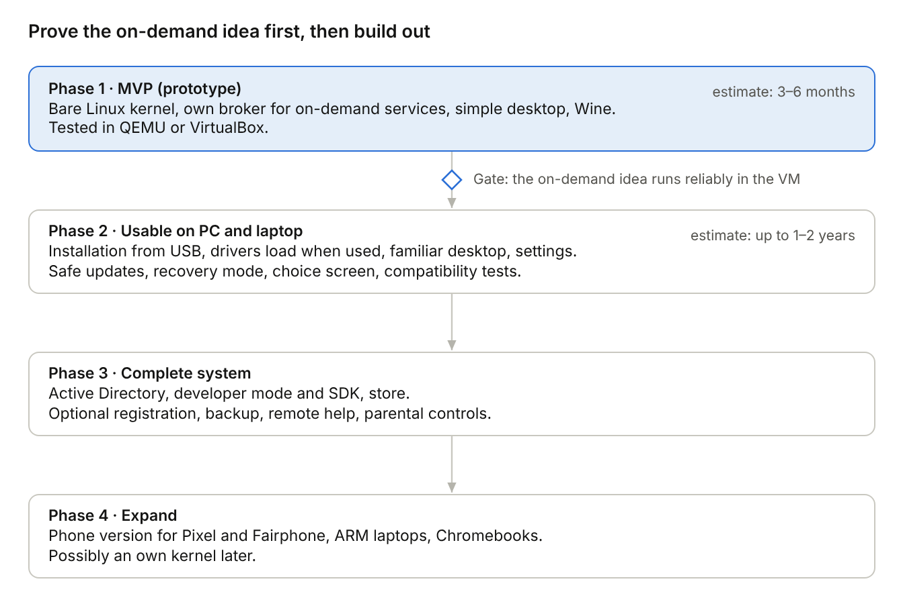

# Roadmap



| Phase | Goal | Gate |
| --- | --- | --- |
| 1. MVP (prototype) | Linux kernel, own broker, simple desktop, Wine. Tested in QEMU. | On-demand idea works reliably in a VM |
| 2. Usable on PC and laptop | USB installation, drivers on demand, familiar desktop, settings, safe updates, recovery, choice screen, compatibility tests | Stable on real hardware |
| 3. Complete system | Active Directory, developer mode and SDK, store, optional registration, backup, remote help, parental controls | First target groups can launch |
| 4. Expand | Phone version (Pixel, Fairphone), ARM laptops, Chromebooks | — |

## First build steps

Development starts in a virtual machine, because a test takes seconds instead of minutes and nothing can break.

| Step | What | Result |
| --- | --- | --- |
| 1 | Build script in Docker | A minimal bootable image: Linux kernel, first broker, simple shell |
| 2 | Automatic test in QEMU | The image boots and a test checks that the broker runs (CI on GitHub Actions) |
| 3 | Hardware report | A tool that shows what is inside a PC and which drivers are missing |
| 4 | USB stick with agent | Boot an empty test PC from USB, run the hardware report, connect a remote developer session |
| 5 | Installer | Partitions, encryption, bootloader. First in QEMU, then on a test PC |

Safety rule: only use an empty test PC, never a PC with important data.

## Proposed repository layout once code starts

```
build/        build scripts and Dockerfiles for the image
broker/       the on-demand broker (Rust)
hardware/     hardware report and driver helper
installer/    installer and migration assistant
desktop/      the desktop shell (Qt 6)
store/        store and package manager
tests/        automated tests in QEMU (openQA later)
docs/         this documentation
```

## Tools

| Task | Tool |
| --- | --- |
| Image build | Docker, Buildroot or Yocto |
| Testing | QEMU with KVM, openQA later |
| Own components | Rust (broker, store, settings back end), Qt 6 (desktop) |
| Windows programs | Wine, DXVK, VKD3D-Proton |
| CI | GitHub Actions |
| Translation | Weblate |
